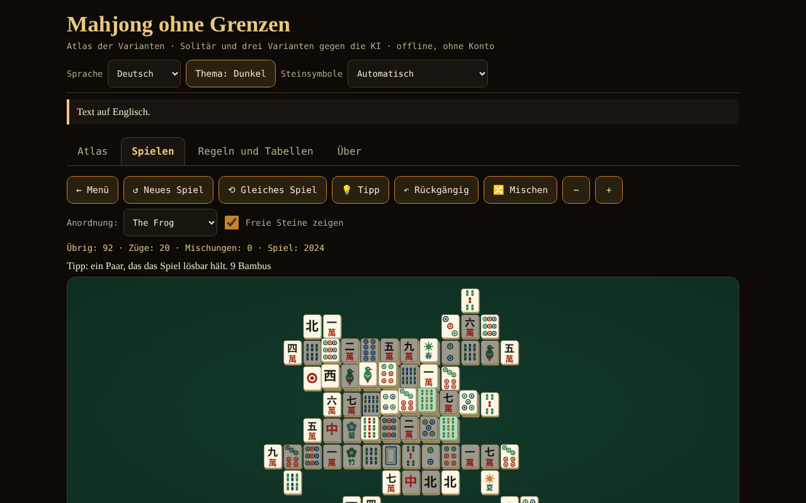

# Mahjong fără frontiere

[English](README.md) · [Română](README.ro.md) · [Français](README.fr.md) · [Italiano](README.it.md) · [Español](README.es.md) · [Português](README.pt.md) · **Deutsch** · [Magyar](README.hu.md)

**Version:** 2.1.0 · **Zuletzt aktualisiert:** 2026-10-27

Oberflächensprachen: **Română, English, Français, Italiano, Español, Português (PT), Deutsch, Magyar**

Atlas der Mahjong-Varianten, Solitaire mit garantiert lösbaren Blättern und Mahjong mit 4 Spielenden gegen 3 KIs (Riichi, Hongkong, Sichuan) — eine einzige HTML-Datei, offline, ohne Konto und ohne Netzwerk.

**Online:** https://chiuta.github.io/Mahjong-fara-frontiere/

## Was es ist

Eine Ein-Datei-App (`index.html`, ~263 KB) aus der Reihe „ohne Grenzen“. Sie hat vier Reiter: **Atlas** (Karten zu 8 Varianten), **Spielen** (die Spiele), **Regeln und Tabellen** (die Punktetabellen, direkt aus dem Code des Spiels erzeugt) und **Über**. Die Oberfläche und alle langen Texte gibt es in 8 Sprachen (Rumänisch, Englisch, Französisch, Italienisch, Spanisch, Portugiesisch, Deutsch und Ungarisch).

„Mahjong“ ist ein Gattungsbegriff. „Shanghai“ ist die Handelsbezeichnung eines Solitaire-Spiels von 1986; hier heißt das Spiel „Mahjong-Solitaire“ (kommerziell als „Shanghai“ bekannt); in den Titeln erscheint keine eingetragene Marke.

## Funktionen (im Code und durch Tests geprüft)

- **Mahjong-Solitaire** mit 8 vom Autor gezeichneten Layouts (Flach, Pyramide, Kreuz, Frosch, Drache, Zitadelle, Schmetterling, Turm; 72–144 Steine). Freier Stein = nichts darüber UND links oder rechts frei. Blumen passen untereinander, Jahreszeiten untereinander. Die Blätter werden **rückwärts** erzeugt (vom leeren Brett aus), sind also lösbar; Tipp (geprüft entweder durch das Erzeugungszertifikat, solange die übrigen Steine es noch erfüllen, oder mit einem Solver mit kleinem Knotenbudget; sonst als „ungeprüft“ gekennzeichnet), unbegrenztes Rückgängigmachen, Mischen der verbleibenden Steine (weiterhin lösbar), reproduzierbare Blattnummer (Seed), Zoom, Tastatur.
- **Mahjong mit 4 Spielenden (du + 3 KIs)** in drei Varianten: **japanisches Riichi**, **Hongkong** und **Sichuan** (siehe die Tabelle unten). Regel-Engine getrennt von der Oberfläche: Ziehen, Abwerfen, Pung/Chow/Kong (Zulässigkeit von der Engine geprüft), Gewinn 4 Sets + Paar, 7 Paare, 13 Waisen, Wertung, Unentschieden, Wechsel des Gebers.
- **Riichi:** Riichi, Ippatsu, Dora/Ura-Dora/Aka, Furiten (eigenes, temporäres, nach Riichi), Kuikae, Chankan, Rinshan, Abbruch bei 9 Waisen, besondere Unentschieden (vier Winde, vier Kans, vier Riichi), Nagashi Mangan, Tenpai-Zahlung, Honba und Riichi-Stäbchen; 42 Einträge in der Tabelle der Yaku/Yakuman/Boni; Fu und Han → Punkte.
- **Hongkong:** 136 oder 144 Steine, Blumen und Jahreszeiten mit Ersatzsteinen, konfigurierbares Mindest-Faan (0–5), Limit (8/10/13), optional sieben Paare, zwei Zahlungsmodi beim Abwurf.
- **Sichuan:** 108 Steine, fehlende Farbe, kein Chow, Mehrfachgewinne („Blutschlacht“, optional), Kong durch Anlegen nur unmittelbar nach dem Ziehen des vierten Steins (MIL-Regel), Kongs werden sofort bezahlt, Strafen bei Erschöpfung.
- **Didaktische KI** (heuristisch: Shanten, verbleibende Steine, Verteidigung; ohne LLM). Sie **schummelt nicht**: Sie entscheidet nur aus öffentlichen Informationen + der eigenen Hand; getestet. Ausdrückliche Ausnahme: die Option „KI-Hände zeigen (nur zum Lernen)“.
- KI-Tipp für deinen Zug (als Heuristik gekennzeichnet, nicht als Urteil), KI-Geschwindigkeit, Dauer (eine Hand / 4 / 8 Runden).
- Steine in eigenem SVG gezeichnet (Kreise, Bambus, Zeichen 一…九, Winde 東南西北, Drachen 中發白, Blumen, Jahreszeiten), mit **automatischer Erkennung** fehlender chinesischer Glyphen und **Ersatz durch lateinische Buchstaben** (auch manuell im Kopf wählbar).
- Dunkles/helles Design, volle Tastaturbedienung (Pfeile, Enter/Leertaste), Ansagen für Screenreader, Touch-Ziele ≥ 44 px, `prefers-reduced-motion`, 390 px ohne horizontales Scrollen.
- Einfache Statistiken, lokal gespeichert, nur in deinem Browser; im Reiter **Über** entfernt die Schaltfläche „Lokale Statistiken löschen“ sie (mit Bestätigung).
- **Kürzel beim Solitaire** (mit Fokus auf dem Brett): `H` Tipp, `U` oder `Ctrl+Z` rückgängig, `S` mischen, zusätzlich zu den Pfeilen und Enter/Leertaste; die Liste erscheint unter dem Brett, in den 8 Sprachen.
- **Die Solitaire-Partie wird automatisch gespeichert** (nach jedem Zug, Rückgängigmachen oder Mischen) und kann im Reiter **Spielen** mit der Schaltfläche „↻ Gespeichertes Spiel fortsetzen“ wieder aufgenommen werden, in den 8 Sprachen. Der Speicherstand wird beim Lesen geprüft (vorhandenes Layout, vollständige Paare, stimmiger Verlauf); beschädigte Daten werden ignoriert. „Lokale Statistiken löschen“ löscht auch die gespeicherte Partie.

## Varianten

| Variante | Spielbar? | ⚠ Annäherungen (kurz; vollständige Liste in der App) |
|---|---|---|
| Mahjong-Solitaire | ja | eigene Layouts; unter 144 Steinen wird eine Teilmenge von Paaren verwendet; die Lösbarkeitsgarantie gilt für das Blatt und das Mischen, nicht für jeden Zug; der Tipp ist nur durch Zertifikat geprüft oder wenn der Solver (kleines Budget) fertig wird |
| Japanisches Riichi | ja | kein Doppel-/Dreifach-Ron (Vorrang für den Nächsten), kein Pao, Renhou, Chankan auf verdecktem Kan, Uma/Oka und „Sudden Death“; Renchan ohne Agari-yame; Kazoe-Yakuman aktiv; keine lokalen Yaku |
| Hongkong | ja | die Tabelle Faan → Punkte („half spicy“) und die Zahlungsmodi sind eine dokumentierte Wahl; es fehlen der Gewinn mit Doppel-Kong und der Sofortgewinn mit 7 Blumen; ein einziger Gewinner beim Abwurf |
| Sichuan | ja | kein Tausch von 3 Steinen; die fehlende Farbe ist öffentlich; das „Blumenschwein“ zahlt 48 zu gleichen Teilen (die Quelle sagt nicht, an wen); vereinfachte Strafen |
| MCR (offiziell chinesisch) | nur im Atlas | — |
| Taiwanisches Mahjong (16 Steine) | nur im Atlas | — |
| Amerikanisches Mahjong | nur im Atlas | die jährliche Karte wird nicht wiedergegeben |
| Sanma (3 Spielende, Japan) | nur im Atlas | — |

## Anleitung

1. Öffne `index.html` (oder die Online-Seite). Wähle die Sprache, das Design und, falls die Steine seltsam aussehen, „Steinsymbole“.
2. Reiter **Atlas**: Lies die Karten (Regeln in Kürze, was nicht originalgetreu ist, Quellen); „▶ Spielen“ führt zum Spiel.
3. Reiter **Spielen**: Wähle das Spiel, stelle die Optionen ein (Layout / Dauer / Mindest-Faan usw., optional Seed) und drücke „▶ Starten“.
4. **Solitaire:** Drücke zwei identische freie Steine (oder bewege den Cursor mit den Pfeilen und drücke Enter). „Tipp“ markiert ein Paar; „Rückgängig“ geht zurück; „Mischen“ erzeugt die verbleibenden Positionen neu, wenn es keine Züge mehr gibt.
5. **Der Tisch mit KIs:** Wenn du dran bist, drücke einen Stein deiner Hand, um ihn abzuwerfen. Für Riichi drücke „Riichi“, dann einen markierten Stein. Wirft eine KI einen Stein ab, der dich interessiert, erscheinen die Schaltflächen Ron / Pung / Chow / Kong / Passen. „KI-Tipp“ zeigt, was die KI tun würde. Am Ende einer Hand siehst du Yaku/Faan/Fan und die Punkteänderungen.
6. Der Reiter **Regeln und Tabellen** enthält die Tabellen der Yaku, Faan und Fan genau so, wie sie im Code stehen, das Glossar und den Steinführer.

## Datenschutz und Netzwerk

Nichts verlässt den Browser: kein fetch/XHR, keine Telemetrie, keine externen Schriften oder Skripte (CSP `default-src 'none'`, Skript nur per Hash erlaubt). `localStorage` wird verwendet (Sprache, Design, Optionen, Statistiken, laufende Solitaire-Partie) in `try/catch`; die App funktioniert auch ohne. Die einzigen externen Links sind die Buy-Me-a-Coffee-Unterstützungsschaltflächen in der Fußzeile (`rel="noopener"`).

## Grenzen und Warnhinweise

- **Es ist kein vollständiges Wettkampfprodukt.** Jede Variante hat ⚠-Annäherungen (die Tabelle oben und die Karten in der App). Regionale Regeln unterscheiden sich: In Hongkong wurden die „half spicy“-Tabelle und die Zahlung beim Abwurf als Option umgesetzt; beim Riichi „Atamahane“ (ein einziger Gewinner beim Abwurf); in Sichuan kein Steintausch.
- **Die KI ist schwach bis mittel.** Sie hat keine Gegnermodelle, spielt Riichi nicht auf Expertenniveau offensiv/defensiv und berechnet keine vollständigen Wahrscheinlichkeiten. Gegen eine Zufallsbasis (60 Spiele pro Variante, Sitzplatz der KI rotiert): Sie gewinnt pro Hand ~52,8 % beim Riichi, ~29,1 % in Hongkong (bei Zufallsbasen sind fast alle Hände Unentschieden, und ein Unentschieden wiederholt den Geber, daher sind die Spiele sehr lang; das Maß ist schwach) und ~71,3 % in Sichuan (Parität = 25 %). Zwischen KIs sind die Partien sehr aggressiv (~89 % der Riichi-Hände enden mit einem Gewinn).
- Alle langen Texte (Atlas, Glossar, Wertungshinweise, die Yaku-Tabellen für Riichi/Hongkong/Sichuan, Namen und Hinweise der 8 Solitaire-Layouts) und die Oberfläche sind in alle 8 Sprachen übersetzt. Unverändert bleiben: das Feld „src“ der Atlaskarten (Wikipedia-Titel, Zitate) und die japanischen/chinesischen Begriffe (Yaku auf Japanisch, Riichi, Dora usw.). Die Übersetzungen ins Französische, Italienische, Spanische, Portugiesische, Deutsche und Ungarische sind automatisch; die Mahjong-Terminologie (besonders hu, de) sollte von einem muttersprachlichen Spieler geprüft werden.
- In Hongkong behält ein Unentschieden den Geber (übliche Regel): Bei hohem Mindest-Faan und passiven Gegnern kann das Spiel lange dauern; senke das Mindest-Faan oder wähle „eine einzige Hand“.
- „Eine einzige Hand“ beendet das Spiel nach der ersten Hand (nicht nach dem Wechsel des Gebers).
- Die Übersetzungen ins Französische, Italienische, Spanische, Portugiesische, Deutsche und Ungarische wurden ohne Prüfung durch Muttersprachler erstellt.
- Bei Schriften ohne chinesische Glyphen wird automatisch auf lateinische Buchstaben umgestellt; liegt die Erkennung falsch, nutze die Auswahl im Kopf.

## Tests (außerhalb des Pakets: `scratchpad/new/games_work/Mahjong-fara-frontiere/`)

Zusammenfassung; Befehle und vollständige Ergebnisse im Bericht `new/reports/Mahjong-fara-frontiere.md`. Die Gewinnhand (4 Sets + Paar, 7 Paare, 13 Waisen) wurde an Tausenden von Händen mit einer Brute-Force-Referenzimplementierung verglichen; die Riichi-Punktetabelle (111 Zellen) und durchgerechnete Beispiele aus Wikipedia und sloperama; die Invariante der Steinanzahl; ≥300 KI-gegen-KI-Partien pro Variante ohne Fehler; 1000 Solitaire-Blätter bis zum leeren Brett erneut gespielt; Prüfung, dass die KI keine verborgenen Informationen sieht; Playwright/Chromium-Prüfung der Oberfläche (alle Layouts, alle Varianten, 8 Sprachen, 390 px).

## Unabhängiges Audit (Zusammenfassung)

Ein separates Audit (Code und Tests unabhängig vom Autor der Engine geschrieben) korrigierte: verdecktes/angelegtes Kong, das unmittelbar nach einem Pung/Chow angeboten wurde (ohne gezogenen Stein); in Hongkong wurden „große Winde“/„vier Quadrate“, die nur aus Ehrensteinen bestanden, mit 10 statt 13 Faan gewertet; der Solitaire-„Tipp“ konnte die Oberfläche einige Sekunden einfrieren (jetzt ein kleines Gesamtbudget); beschädigte `localStorage`-Daten konnten den Spielstart verhindern; in Sichuan blieb ein „geraubter“ Kong-Stein (Chankan) aus der Hand verloren; rumänische Beschriftung „sângele curge“ → „bătălia de sânge“. Weiterhin ungeprüft: das Rendering in Firefox/Safari ohne chinesische Schriften (nur in Chromium getestet, mit und ohne CJK-Schriften) und die Übersetzungen fr/it/es/pt/de ohne Muttersprachler.

## Quellen

Zur Umsetzung und Überprüfung herangezogene Regeln (Wikipedia-Artikel, ohne Textübernahme): „Mahjong“, „Mahjong solitaire“, „Japanese mahjong“, „Japanese mahjong yaku“, „Japanese mahjong scoring rules“ (die Punktetabelle und durchgerechnete Beispiele), „Hong Kong mahjong“, „Sichuan mahjong“, „Mahjong Competition Rules“, „Taiwanese mahjong“, „American mahjong“; das Beispiel zur Fu-Berechnung (90 Fu) von sloperama.com. Wikipedia kann Fehler oder regionale Unterschiede enthalten; die Atlas-Karten sagen, welche Variante gewählt wurde.

## Lokal ausführen

Öffne `index.html` in einem Browser (ohne Server, ohne Installation). Zum Neuaufbau aus den Quellen: `node build_site.js` im Arbeitsordner (das Skript macht keine Netzwerkaufrufe).

## Lizenz

MIT — siehe die Datei `LICENSE`.

## Autor

Alexio — Alexandru-Ionuț Chiuță · alexio@trom.tf

## Zusammenfassung
„Mahjong ohne Grenzen“ ist eine Ein-Datei-HTML-App, offline: ein Atlas von acht Mahjong-Varianten, ein Mahjong-Solitaire mit acht selbst gezeichneten Layouts und rückwärts konstruierten (garantiert lösbaren) Blättern sowie Mahjong zu viert gegen drei heuristische KIs in drei spielbaren Varianten — japanisches Riichi, Hongkong und Sichuan.; auch alle langen Texte (Atlas, Glossar, Wertungshinweise) sind übersetzt. Die Steine werden als SVG gezeichnet, mit automatischem Ersatz durch lateinische Buchstaben, wenn chinesische Glyphen fehlen. Die Oberfläche ist auf Rumänisch, Englisch, Französisch, Italienisch, Spanisch, Portugiesisch, Deutsch und Ungarisch; lange Texte (Atlas, Glossar, Wertungshinweise) gibt es nur auf Rumänisch und Englisch und werden in den anderen Sprachen auf Englisch mit einem kleinen Hinweis angezeigt. Die KI schummelt nicht (sie sieht nur öffentliche Informationen und ihre eigene Hand; eine ausdrückliche Lernoption „KI-Hände zeigen“ ist die einzige Ausnahme). Jede Regelannäherung ist in der App und in der Tabelle oben mit ⚠ gekennzeichnet. Kein Netzwerkzugriff, kein Tracking; strenge CSP. Lizenz: MIT (siehe LICENSE).

## Neue Funktionen (v1.1.0)

- **Solitaire-Duell im Netzwerk** („Netzwerk-Duell (gleiches Brett)“): Beide Spielenden erhalten dasselbe Brett (gleicher Seed und gleiches Layout) und lösen parallel; jeder sieht den Fortschritt des anderen, und am Ende werden die Ergebnisse verglichen. Im Duell sind Tipps, neues Spiel und Fortsetzen deaktiviert, und der lokale Speicherstand bleibt unberührt. Es ist kein Mahjong zu viert: Mehr erlaubt Solitaire ehrlicherweise nicht. Die Verbindung wird direkt zwischen den beiden Browsern hergestellt (WebRTC), ohne einen Server von uns: Du tauschst zwei Texte (Angebot/Antwort) aus, als Text oder QR-Code, über einen beliebigen Kanal deiner Wahl. Standardmäßig wird kein STUN-Server kontaktiert; einer kann im Verbindungsfenster manuell eingetragen werden, nur wenn du es willst. Bricht die Verbindung ab, zeigt die App es an und kann das Spiel aus dem Zugprotokoll fortsetzen.
- **Vorlesen der Atlas-Karten** (Schaltfläche „Anhören“, FFF.tts).
- Gemeinsames Kit (core, label, bundle, qr, p2p, tts).
- Die neuen Texte liegen in allen Sprachen der App vor (einschließlich hu/de, wo ein i18n-System existiert); die automatischen Übersetzungen sind nicht von Muttersprachlern geprüft.
- Tests: `tests/fff-r8.test.mjs` (Netzwerk gesperrt, zwei Kontexte über den echten Dialog verbunden, axe 0 Verstöße bei 1280 und 360 px).

## Verlauf / Changelog

### 1.2.8 — 2026-10-23

- Fix: Der Sichuan-Modus war nicht spielbar — die Wertungsfunktion (`evalSichuan`) rief eine undefinierte Funktion (`LT`) auf und warf `ReferenceError`, sobald eine Hand ausgewertet wurde. Neuer Engine-Simulationstest (4 KIs, 3 Regeln, Punkte erhalten).

### 1.2.7 — 2026-10-23

- Speicher: Die Schlüssel tragen jetzt das App-Präfix (`mahjong.*`); vorhandene Daten werden beim Start automatisch von den alten Schlüsseln (`mjfb.*`) übernommen, und ältere `.fff.json`-Sicherungen lassen sich weiterhin importieren (fff-kit 1.2.0).
- Dialoge: Die nativen Boxen `alert`/`confirm`/`prompt` wurden durch barrierefreie, übersetzte `FFF.dialog`-Dialoge ersetzt (Tastatur, Fokusfalle, Esc) – mit unverändertem Verhalten (fff-kit 1.2.0).

### 1.2.5 — 2026-10-22

fff-kit 1.1.4: Touch-Ziele und Mindestschriftgröße.

### 1.2.4 — 2026-10-22

fff-kit 1.1.2: PBKDF2 mit 600.000 Iterationen, Schutz vor Clickjacking.

### 1.2.3 — 2026-10-22

das Löschen der Statistik fragt im Inline-Dialog des Kits (in 8 Sprachen übersetzt) statt im blockierenden `window.confirm()` nach; sichtbarer Tastaturfokus; das Versionsetikett hat ein ausreichend großes Touch-Ziel; Test `tests/r9-confirm.test.mjs`. Das technische Etikett listet jetzt alle 8 Oberflächensprachen.

### 1.2.2 — 2026-10-22
- Glossar: Die Begriffe „Mauer / Tote Mauer“ und „Fehlende Farbe“ sind in alle Sprachen übersetzt.

### 2026-10-19 (v1.2.1)
- Alle langen Texte (Atlas der 8 Varianten, Glossar, Wertungshinweise, rund 90 Yaku-Einträge, die 8 Solitaire-Layouts) sind nach fr, it, es, pt, de, hu übersetzt; der Hinweis „Text auf Englisch“ erscheint nicht mehr. Automatische Übersetzungen, nicht von Muttersprachlern geprüft.

### 14. Oktober 2026 (v1.1.0)
- Neu: Solitaire-Duell im Netzwerk (gleiches Brett), Vorlesen der Karten, gemeinsames Kit, Tests.

- 1.0.0 — 2026-10-12: Die Version und das Datum der letzten Aktualisierung werden in der App angezeigt
- **11. Oktober 2026** (Runde 7) — automatisches Speichern und Fortsetzen der Solitaire-Partie (geprüft, 7 Sprachen, im Datenschutztext enthalten); im Browser getestet (Zug → Neuladen → Fortsetzen mit derselben Steinanzahl; beschädigter Speicherstand ignoriert); 0 Fehler, axe 0 Verstöße bei 1280×800 und 360×740.
- **11. Oktober 2026** — Tastaturkürzel beim Solitaire (H / U oder Strg+Z / S) mit Erläuterung unter dem Brett, Schaltfläche „Lokale Statistiken löschen“ unter Über (Texte in 7 Sprachen); CSP-Hash des Skripts neu berechnet; getestet (0 Fehler, 0 CSP-Verstöße, axe-core 0 Verstöße bei 1280×800 und 360×740).
- **11. Oktober 2026** — die Meldung am Tisch sagt nicht mehr „You is thinking…“ (wenn der formale Zug bei dir liegt, die Aktion aber von den anderen aufgelöst wird, erscheint „Warte auf die anderen Spielenden …“, in allen 7 Sprachen); der Zähler „Züge“ beim Solitaire wird beim Mischen nicht mehr zurückgesetzt (er hat einen eigenen Zähler, der beim Mischen erhalten bleibt und beim Rückgängigmachen sinkt).
- Barrierefreiheit: Die Reiterleiste liegt in einem `nav` mit eigenem `tablist`, die Titel der Atlas-Karten sind `h2` (richtige Überschriftenreihenfolge), das Unterstützungs-Widget hat die Rolle `complementary`; axe-core: 0 Verstöße bei 1280×800 und 360×740. Der CSP-Hash des Skripts wurde neu berechnet. Die App hat keine Versionsnummer.
