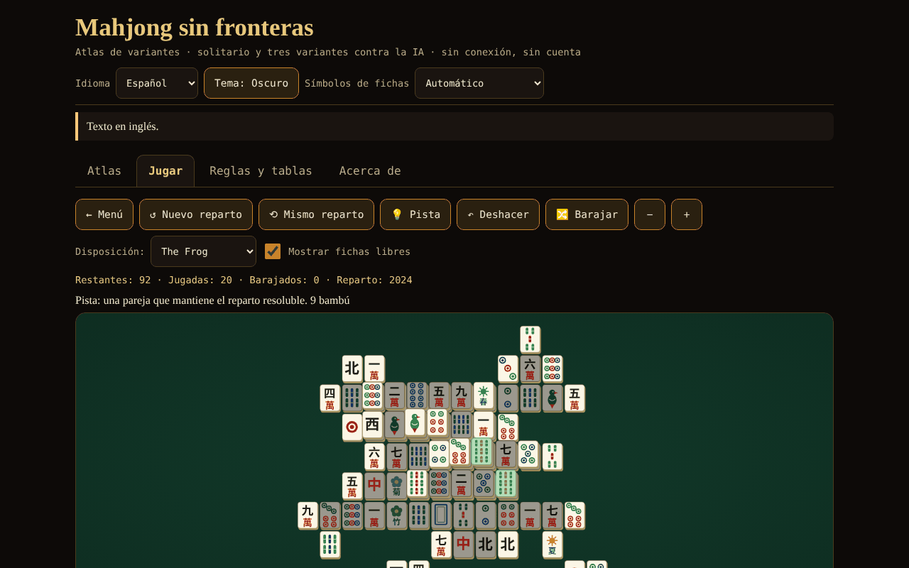

# Mahjong fără frontiere

[English](README.md) · [Română](README.ro.md) · [Français](README.fr.md) · [Italiano](README.it.md) · **Español** · [Português](README.pt.md) · [Deutsch](README.de.md) · [Magyar](README.hu.md)

**Versión:** 1.2.1 · **Última actualización:** 2026-10-19

Idiomas de la interfaz: **Română, English, Français, Italiano, Español, Português (PT), Deutsch, Magyar**

Atlas de variantes de mahjong, solitario con repartos garantizados resolubles y mahjong de 4 jugadores contra 3 IA (riichi, Hong Kong, Sichuan) — un único archivo HTML, sin conexión, sin cuenta y sin red.

**En línea:** https://chiuta.github.io/Mahjong-fara-frontiere/

## Qué es

Una aplicación de un solo archivo (`index.html`, ~263 KB) de la serie «sin fronteras». Tiene cuatro pestañas: **Atlas** (fichas sobre 8 variantes), **Jugar** (los juegos), **Reglas y tablas** (las tablas de puntuación generadas directamente a partir del código del juego) y **Acerca de**. La interfaz está en rumano y, a elección, en inglés, francés, italiano, español, portugués, alemán y húngaro.

«Mahjong» es un término genérico. «Shanghai» es el nombre comercial de un juego de solitario de 1986; aquí el juego se llama «Mahjong solitario» (conocido comercialmente como «Shanghai»); ninguna marca registrada aparece en los títulos.

## Funciones (verificadas en el código y con pruebas)

- **Mahjong solitario** con 8 disposiciones dibujadas por el autor (Plana, Pirámide, Cruz, Rana, Dragón, Ciudadela, Mariposa, Torre; 72–144 fichas). Ficha libre = nada encima Y lado izquierdo o derecho libre. Las flores se emparejan entre sí, las estaciones entre sí. Los repartos se generan **a la inversa** (desde el tablero vacío), por lo que son resolubles; pista (verificada o bien por el certificado de generación, mientras las fichas restantes aún lo cumplan, o bien con un solver de presupuesto bajo de nodos; si no, marcada «no verificada»), deshacer ilimitado, mezcla de las fichas restantes (también resoluble), número de reparto (seed) reproducible, zoom, teclado.
- **Mahjong de 4 jugadores (tú + 3 IA)** en tres variantes: **riichi japonés**, **Hong Kong** y **Sichuan** (véase la tabla de abajo). Motor de reglas separado de la interfaz: robo, descarte, pung/chow/kong (con legalidad verificada por el motor), victoria 4 grupos + pareja, 7 parejas, 13 huérfanos, puntuación, empates, rotación del dealer.
- **Riichi:** riichi, ippatsu, dora/ura-dora/aka, furiten (propio, temporal, tras riichi), kuikae, chankan, rinshan, abandono por 9 huérfanos, empates especiales (cuatro vientos, cuatro kans, cuatro riichi), nagashi mangan, pago de tenpai, honba y varillas de riichi; 42 entradas en la tabla de yaku/yakuman/bonificaciones; fu y han → puntos.
- **Hong Kong:** 136 o 144 fichas, flores y estaciones con fichas de reemplazo, faan mínimo configurable (0–5), límite (8/10/13), siete parejas opcional, dos modos de pago al descartar.
- **Sichuan:** 108 fichas, palo faltante, sin chow, victorias múltiples («batalla sangrienta», opcional), kong por adición solo inmediatamente después de robar la cuarta ficha (regla MIL), kongs pagados de inmediato, penalizaciones por agotamiento.
- **IA didáctica** (heurística: shanten, fichas restantes, defensa; sin LLM). **No hace trampa**: decide solo a partir de la información pública + su propia mano; probado. Excepción explícita: la opción «Mostrar las manos de la IA (solo para aprender)».
- Pista de la IA para tu jugada (marcada como heurística, no como veredicto), velocidad de la IA, duración (una mano / 4 / 8 rotaciones).
- Fichas dibujadas en SVG propio (círculos, bambú, caracteres 一…九, vientos 東南西北, dragones 中發白, flores, estaciones), con **detección automática** de la falta de glifos chinos y **alternativa con letras latinas** (también se puede elegir manualmente desde la cabecera).
- Tema oscuro/claro, teclado completo (flechas, Intro/Espacio), anuncios para lectores de pantalla, objetivos táctiles ≥ 44 px, `prefers-reduced-motion`, 390 px sin desplazamiento horizontal.
- Estadísticas sencillas, guardadas en local, solo en tu navegador; en la pestaña **Acerca de** el botón «Borrar las estadísticas locales» las elimina (con confirmación).
- **Atajos en el solitario** (con el foco en el tablero): `H` pista, `U` o `Ctrl+Z` deshacer, `S` mezclar, además de las flechas e Intro/Espacio; la lista aparece bajo el tablero, en los 8 idiomas.
- **La partida de solitario se guarda automáticamente** (tras cada jugada, deshacer o mezcla) y se puede reanudar desde la pestaña **Jugar** con el botón «↻ Continuar la partida guardada», en los 8 idiomas. El guardado se valida al leerlo (disposición existente, parejas completas, historial coherente); los datos corruptos se ignoran. «Borrar las estadísticas locales» borra también la partida guardada.

## Variantes

| Variante | ¿Jugable? | ⚠ Aproximaciones (en breve; lista completa en la aplicación) |
|---|---|---|
| Mahjong solitario | sí | disposiciones propias; por debajo de 144 fichas se usa un subconjunto de parejas; la garantía de resolubilidad es para el reparto y las mezclas, no para cualquier jugada; la pista solo se verifica por certificado o cuando el solver (de presupuesto bajo) termina |
| Riichi japonés | sí | sin ron doble/triple (prioridad al más cercano), sin pao, renhou, chankan sobre kong oculto, uma/oka ni «sudden death»; renchan sin agari-yame; kazoe yakuman activo; sin yaku locales |
| Hong Kong | sí | la tabla faan → puntos («half spicy») y los modos de pago son una elección documentada; faltan la victoria con doble kong y la instantánea con 7 flores; un único ganador al descartar |
| Sichuan | sí | sin intercambio de 3 fichas; el palo faltante es público; el «cerdo de flores» paga 48 repartidos a partes iguales (la fuente no dice a quién); penalizaciones simplificadas |
| MCR (oficial chino) | solo en el atlas | — |
| Mahjong taiwanés (16 fichas) | solo en el atlas | — |
| Mahjong americano | solo en el atlas | la tarjeta anual no se reproduce |
| Sanma (3 jugadores, Japón) | solo en el atlas | — |

## Manual de uso

1. Abre `index.html` (o la página En línea). Elige el idioma, el tema y, si las fichas se ven raras, «Símbolos de las fichas».
2. Pestaña **Atlas**: lee las fichas (reglas en breve, lo que no es fiel, fuentes); «▶ Jugar» lleva al juego.
3. Pestaña **Jugar**: elige el juego, ajusta las opciones (disposición / duración / faan mínimo, etc., seed opcional) y pulsa «▶ Empezar».
4. **Solitario:** pulsa dos fichas libres idénticas (o mueve el cursor con las flechas y pulsa Intro). «Pista» marca una pareja; «Deshacer» retrocede; «Mezclar» regenera las posiciones restantes cuando ya no hay jugadas.
5. **La mesa con IA:** cuando es tu turno, pulsa una ficha de tu mano para descartarla. Para riichi pulsa «Riichi» y luego una ficha marcada. Cuando una IA descarta una ficha que te interesa aparecen los botones Ron / Pung / Chow / Kong / Paso. «Pista de la IA» muestra lo que haría la IA. Al final de la mano ves los yaku/faan/fan y los cambios de puntuación.
6. La pestaña **Reglas y tablas** contiene las tablas de yaku, faan y fan exactamente como están en el código, el glosario y la guía de fichas.

## Privacidad y red

Nada sale del navegador: sin fetch/XHR, sin telemetría, sin fuentes ni scripts externos (CSP `default-src 'none'`, script permitido solo por hash). Se usa `localStorage` (idioma, tema, opciones, estadísticas, partida de solitario en curso) dentro de `try/catch`; la aplicación funciona también sin él. Los únicos enlaces externos son los botones de apoyo de Buy Me a Coffee del pie (`rel="noopener"`).

## Límites y advertencias

- **No es un producto de competición completo.** Cada variante tiene aproximaciones ⚠ (la tabla de arriba y las fichas de la aplicación). Las reglas regionales difieren: en Hong Kong se implementó la tabla «half spicy» y el pago al descartar como opción; en riichi, «atamahane» (un único ganador al descartar); en Sichuan, sin intercambio de fichas.
- **La IA es de nivel débil a medio.** No tiene modelos del adversario, no juega el riichi ofensivo/defensivo a nivel experto y no calcula probabilidades completas. Contra una base aleatoria (60 partidas por variante, con el asiento de la IA rotado): gana por mano ~52,8 % en riichi, ~29,1 % en Hong Kong (con las bases aleatorias casi todas las manos son empates, y el empate repite al dealer, por lo que las partidas son muy largas; la medida es débil) y ~71,3 % en Sichuan (paridad = 25 %). Entre IA las partidas son muy agresivas (~89 % de las manos de riichi terminan con una victoria).
- Los textos largos (atlas, glosario, notas de puntuación) existen solo en **rumano e inglés**; en los otros 6 idiomas se muestra el texto en inglés, con una nota discreta («texto en inglés»). Los elementos de la interfaz están traducidos a los 8 idiomas (paridad verificada por script).
- En Hong Kong, el empate mantiene al dealer (regla habitual): con un faan mínimo alto y adversarios pasivos la partida puede durar mucho; baja el faan mínimo o elige «una sola mano».
- «Una sola mano» detiene el juego tras la primera mano (no tras la rotación del dealer).
- Las traducciones al francés, italiano, español, portugués, alemán y húngaro se hicieron sin verificación por hablantes nativos.
- Con fuentes sin glifos chinos se pasa automáticamente a letras latinas; si la detección se equivoca, usa el selector de la cabecera.

## Pruebas (fuera del paquete: `scratchpad/new/games_work/Mahjong-fara-frontiere/`)

Resumen; comandos y resultados completos en el informe `new/reports/Mahjong-fara-frontiere.md`. Mano ganadora (4 grupos + pareja, 7 parejas, 13 huérfanos) comparada con una implementación de referencia por fuerza bruta en miles de manos; tabla de puntos de riichi (111 celdas) y ejemplos resueltos de Wikipedia y sloperama; invariante del número de fichas; ≥300 partidas IA contra IA por variante sin errores; 1000 repartos de solitario rejugados hasta el tablero vacío; verificación de que la IA no ve información oculta; verificación con Playwright/Chromium de la interfaz (todas las disposiciones, todas las variantes, 8 idiomas, 390 px).

## Auditoría independiente (resumen)

Una auditoría separada (código y pruebas escritos con independencia del autor del motor) corrigió: kong oculto/por adición ofrecido inmediatamente después de un pung/chow (sin ficha robada); en Hong Kong, los «grandes vientos»/«cuatro cuadros» formados solo por honores se puntuaban 10 en lugar de 13 faan; la «Pista» del solitario podía congelar la interfaz unos segundos (ahora un presupuesto total pequeño); datos corruptos de `localStorage` podían impedir el arranque del juego; en Sichuan, una ficha de kong «robada» (chankan) seguía perdida de la mano; etiqueta rumana «sângele curge» → «bătălia de sânge». Siguen sin verificar: el renderizado en Firefox/Safari sin fuentes chinas (probado solo en Chromium, con y sin fuentes CJK) y las traducciones fr/it/es/pt/de sin hablantes nativos.

## Fuentes

Reglas consultadas para la implementación y la verificación (artículos de Wikipedia, sin copiar texto): «Mahjong», «Mahjong solitaire», «Japanese mahjong», «Japanese mahjong yaku», «Japanese mahjong scoring rules» (la tabla de puntos y los ejemplos resueltos), «Hong Kong mahjong», «Sichuan mahjong», «Mahjong Competition Rules», «Taiwanese mahjong», «American mahjong»; el ejemplo de cálculo del fu (90 fu) de sloperama.com. Wikipedia puede contener errores o diferencias regionales; las fichas del atlas dicen qué variante se eligió.

## Ejecución local

Abre `index.html` en un navegador (sin servidor, sin instalación). Para reconstruir desde las fuentes: `node build_site.js` en la carpeta de trabajo (el script no hace llamadas de red).

## Licencia

MIT — véase el archivo `LICENSE`.

## Autor

Alexio — Alexandru-Ionuț Chiuță · alexio@trom.tf

## Resumen

«Mahjong sin fronteras» es una aplicación HTML de un solo archivo, sin conexión: un atlas de ocho variantes de mahjong, un mahjong solitario con ocho disposiciones dibujadas por el autor y repartos construidos a la inversa (garantizados resolubles), y un mahjong de cuatro asientos contra tres IA heurísticas en tres variantes jugables — riichi japonés, Hong Kong y Sichuan. MCR, taiwanés, americano y de tres jugadores (sanma) son solo del atlas. Las fichas se dibujan en SVG con una alternativa automática de letras latinas cuando faltan los glifos chinos. La interfaz está en rumano, inglés, francés, italiano, español, portugués, alemán y húngaro; los textos largos (atlas, glosario, notas de puntuación) existen solo en rumano e inglés y se muestran en inglés, con una pequeña nota, en los demás idiomas. La IA no hace trampa (solo ve la información pública y su propia mano; una opción explícita de aprendizaje «mostrar las manos de la IA» es la única excepción). Cada aproximación de reglas está marcada con ⚠ en la aplicación y en la tabla de arriba. Sin acceso a la red, sin rastreo; CSP estricta. Licencia: MIT (véase LICENSE).

## Funciones nuevas (v1.1.0)

- **Duelo de solitario en red** («Duelo en red (mismo tablero)»): ambos jugadores reciben el mismo tablero (la misma seed y disposición) y resuelven en paralelo; cada uno ve el progreso del otro, y al final se comparan los resultados. En el duelo se desactivan las pistas, la partida nueva y la reanudación, y el guardado local no se toca. No es Mahjong de cuatro jugadores: eso es todo lo que permite honestamente el solitario. La conexión se hace directamente entre los dos navegadores (WebRTC), sin servidor nuestro: intercambias dos textos (oferta/respuesta), como texto o código QR, por el canal que elijas. Por defecto no se contacta ningún servidor STUN; se puede introducir uno manualmente en la ventana de conexión, solo si lo quieres. Si el enlace se interrumpe, la aplicación lo muestra y puede reanudar la partida desde el registro de jugadas.
- **Lectura en voz alta de las fichas del atlas** (botón «Escuchar», FFF.tts).
- Kit común (core, label, bundle, qr, p2p, tts).
- Los textos nuevos están en todos los idiomas de la aplicación (incluidos hu/de donde existe un sistema i18n); las traducciones automáticas no están verificadas por hablantes nativos.
- Pruebas: `tests/fff-r8.test.mjs` (red bloqueada, dos contextos conectados mediante el diálogo real, axe 0 infracciones a 1280 y 360 px).

## Historial / Changelog

### 14 de octubre de 2026 (v1.1.0)
- Novedad: duelo de solitario en red (mismo tablero), lectura en voz alta de las fichas, kit común, pruebas.

- 1.0.0 — 2026-10-12: la versión y la fecha de la última actualización se muestran en la aplicación
- **11 de octubre de 2026** (ronda 7) — guardado automático y reanudación de la partida de solitario (validados, 7 idiomas, incluidos en el texto de privacidad); probado en el navegador (jugada → recarga → reanudación con el mismo número de fichas; guardado corrupto ignorado); 0 errores, axe 0 infracciones a 1280×800 y 360×740.
- **11 de octubre de 2026** — atajos de teclado en el solitario (H / U o Ctrl+Z / S) con explicación bajo el tablero, botón «Borrar las estadísticas locales» en Acerca de (textos en 7 idiomas); hash CSP del script recalculado; probado (0 errores, 0 infracciones CSP, axe-core 0 infracciones a 1280×800 y 360×740).
- **11 de octubre de 2026** — el mensaje en la mesa ya no dice «You is thinking…» (cuando el turno formal es tuyo pero la acción la resuelven los demás, aparece «Esperando a los demás jugadores…», en los 7 idiomas); el contador «Jugadas» del solitario ya no se reinicia al mezclar (tiene su propio contador, conservado al mezclar, reducido al deshacer).
- Accesibilidad: la barra de pestañas está en un `nav` con un `tablist` separado, los títulos de las fichas del Atlas son `h2` (orden correcto de los títulos), el widget de apoyo tiene el rol `complementary`; axe-core: 0 infracciones a 1280×800 y 360×740. El hash CSP del script se recalculó. La aplicación no tiene número de versión.
