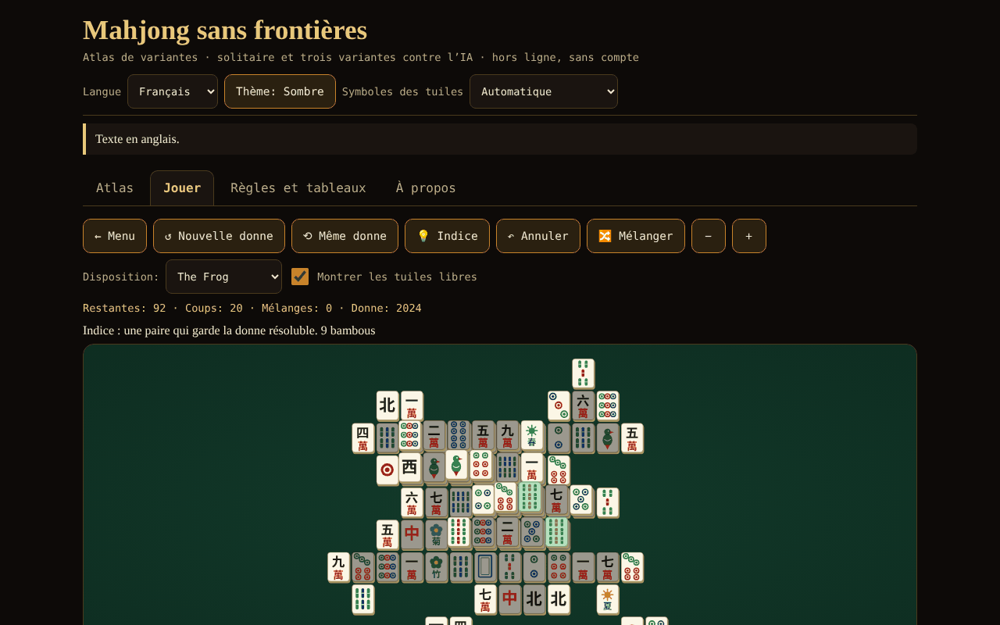

# Mahjong fără frontiere

[English](README.md) · [Română](README.ro.md) · **Français** · [Italiano](README.it.md) · [Español](README.es.md) · [Português](README.pt.md) · [Deutsch](README.de.md) · [Magyar](README.hu.md)

**Version :** 1.2.8 · **Dernière mise à jour :** 2026-10-23

Langues de l'interface : **Română, English, Français, Italiano, Español, Português (PT), Deutsch, Magyar**

Atlas de variantes de mahjong, solitaire avec donnes garanties résolubles et mahjong à 4 joueurs contre 3 IA (riichi, Hong Kong, Sichuan) — un seul fichier HTML, hors ligne, sans compte et sans réseau.

**En ligne :** https://chiuta.github.io/Mahjong-fara-frontiere/

## Ce que c'est

Une application en un seul fichier (`index.html`, ~263 Ko) de la série « sans frontières ». Elle comporte quatre onglets : **Atlas** (fiches sur 8 variantes), **Jouer** (les jeux), **Règles et tableaux** (les tableaux de score générés directement à partir du code du jeu) et **À propos**. L'interface et tous les textes longs sont en 8 langues (roumain, anglais, français, italien, espagnol, portugais, allemand et hongrois).

« Mahjong » est un terme générique. « Shanghai » est le nom commercial d'un jeu de solitaire de 1986 ; ici le jeu s'appelle « Mahjong solitaire » (connu commercialement sous le nom de « Shanghai ») ; aucune marque déposée n'apparaît dans les titres.

## Fonctions (vérifiées dans le code et par des tests)

- **Mahjong solitaire** avec 8 dispositions dessinées par l'auteur (Plat, Pyramide, Croix, Grenouille, Dragon, Citadelle, Papillon, Tour ; 72–144 tuiles). Tuile libre = rien au-dessus ET côté gauche ou droit libre. Les fleurs s'associent entre elles, les saisons entre elles. Les donnes sont générées **à l'envers** (à partir du plateau vide), elles sont donc résolubles ; suggestion (vérifiée soit par le certificat de génération, tant que les tuiles restantes le respectent encore, soit par un solveur à petit budget de nœuds ; sinon marquée « non vérifiée »), annulation illimitée, mélange des tuiles restantes (toujours résoluble), numéro de donne (seed) reproductible, zoom, clavier.
- **Mahjong à 4 joueurs (vous + 3 IA)** en trois variantes : **riichi japonais**, **Hong Kong** et **Sichuan** (voir le tableau ci-dessous). Moteur de règles séparé de l'interface : pioche, défausse, pung/chow/kong (légalité vérifiée par le moteur), victoire 4 groupes + paire, 7 paires, 13 orphelins, calcul des points, parties nulles, rotation du donneur.
- **Riichi :** riichi, ippatsu, dora/ura-dora/aka, furiten (propre, temporaire, après riichi), kuikae, chankan, rinshan, abandon pour 9 orphelins, parties nulles spéciales (quatre vents, quatre kans, quatre riichi), nagashi mangan, paiement du tenpai, honba et bâtons de riichi ; 42 entrées dans le tableau des yaku/yakuman/bonus ; fu et han → points.
- **Hong Kong :** 136 ou 144 tuiles, fleurs et saisons avec tuiles de remplacement, faan minimum configurable (0–5), plafond (8/10/13), sept paires en option, deux modes de paiement à la défausse.
- **Sichuan :** 108 tuiles, couleur manquante, pas de chow, victoires multiples (« bataille sanglante », en option), kong par ajout seulement immédiatement après la pioche de la quatrième tuile (règle MIL), kongs payés immédiatement, pénalités à l'épuisement.
- **IA didactique** (heuristique : shanten, tuiles restantes, défense ; sans LLM). Elle **ne triche pas** : elle décide uniquement à partir de l'information publique + sa propre main ; testé. Exception explicite : l'option « Montrer les mains de l'IA (pour apprendre uniquement) ».
- Suggestion d'IA pour votre coup (signalée comme heuristique, non comme verdict), vitesse de l'IA, durée (une main / 4 / 8 rotations).
- Tuiles dessinées en SVG propre (cercles, bambous, caractères 一…九, vents 東南西北, dragons 中發白, fleurs, saisons), avec **détection automatique** de l'absence de glyphes chinois et **alternative en lettres latines** (on peut aussi la choisir manuellement depuis l'en-tête).
- Thème sombre/clair, clavier complet (flèches, Entrée/Espace), annonces pour lecteurs d'écran, cibles tactiles ≥ 44 px, `prefers-reduced-motion`, 390 px sans défilement horizontal.
- Statistiques simples, enregistrées en local, uniquement dans votre navigateur ; dans l'onglet **À propos**, le bouton « Effacer les statistiques locales » les supprime (avec confirmation).
- **Raccourcis au solitaire** (focus sur le plateau) : `H` suggestion, `U` ou `Ctrl+Z` annule, `S` mélange, en plus des flèches et d'Entrée/Espace ; la liste apparaît sous le plateau, dans les 8 langues.
- **La partie de solitaire est enregistrée automatiquement** (après chaque coup, annulation ou mélange) et peut être reprise depuis l'onglet **Jouer** avec le bouton « ↻ Continuer la partie enregistrée », dans les 8 langues. La sauvegarde est validée à la lecture (disposition existante, paires complètes, historique cohérent) ; les données corrompues sont ignorées. « Effacer les statistiques locales » efface aussi la partie enregistrée.

## Variantes

| Variante | Jouable ? | ⚠ Approximations (en bref ; liste complète dans l'application) |
|---|---|---|
| Mahjong solitaire | oui | dispositions propres ; en dessous de 144 tuiles, on utilise un sous-ensemble de paires ; la garantie de résolubilité vaut pour la donne et les mélanges, pas pour n'importe quel coup ; la suggestion n'est vérifiée que par certificat ou lorsque le solveur (petit budget) termine |
| Riichi japonais | oui | pas de ron double/triple (priorité au joueur le plus proche), pas de pao, renhou, chankan sur kong caché, uma/oka et « mort subite » ; renchan sans agari-yame ; kazoe yakuman actif ; pas de yaku locaux |
| Hong Kong | oui | le tableau faan → points (« half spicy ») et les modes de paiement sont un choix documenté ; manquent : la victoire avec double kong et la victoire instantanée avec 7 fleurs ; un seul gagnant à la défausse |
| Sichuan | oui | pas d'échange de 3 tuiles ; la couleur manquante est publique ; le « cochon de fleur » paie 48 répartis à parts égales (la source ne dit pas à qui) ; pénalités simplifiées |
| MCR (officiel chinois) | atlas seulement | — |
| Mahjong taïwanais (16 tuiles) | atlas seulement | — |
| Mahjong américain | atlas seulement | la carte annuelle n'est pas reproduite |
| Sanma (3 joueurs, Japon) | atlas seulement | — |

## Mode d'emploi

1. Ouvrez `index.html` (ou la page En ligne). Choisissez la langue, le thème et, si les tuiles ont un aspect étrange, « Symboles des tuiles ».
2. Onglet **Atlas** : lisez les fiches (règles en bref, ce qui n'est pas fidèle, sources) ; « ▶ Jouer » mène au jeu.
3. Onglet **Jouer** : choisissez le jeu, réglez les options (disposition / durée / faan minimum, etc., seed facultatif) et appuyez sur « ▶ Commencer ».
4. **Solitaire :** appuyez sur deux tuiles libres identiques (ou déplacez le curseur avec les flèches et appuyez sur Entrée). « Suggestion » marque une paire ; « Annuler » revient en arrière ; « Mélanger » régénère les positions restantes lorsqu'il n'y a plus de coups.
5. **La table avec IA :** quand c'est votre tour, appuyez sur une tuile de votre main pour la défausser. Pour le riichi, appuyez sur « Riichi », puis sur une tuile marquée. Lorsqu'une IA défausse une tuile qui vous intéresse, les boutons Ron / Pung / Chow / Kong / Passer apparaissent. « Suggestion de l'IA » montre ce que ferait l'IA. En fin de main, vous voyez les yaku/faan/fan et les variations de score.
6. L'onglet **Règles et tableaux** contient les tableaux de yaku, faan et fan exactement comme dans le code, le glossaire et le guide des tuiles.

## Confidentialité et réseau

Rien ne quitte le navigateur : pas de fetch/XHR, pas de télémétrie, pas de polices ni de scripts externes (CSP `default-src 'none'`, script autorisé uniquement par hachage). On utilise `localStorage` (langue, thème, options, statistiques, partie de solitaire en cours) dans un `try/catch` ; l'application fonctionne aussi sans. Les seuls liens externes sont les boutons de soutien Buy Me a Coffee du pied de page (`rel="noopener"`).

## Limites et avertissements

- **Ce n'est pas un produit de compétition complet.** Chaque variante comporte des approximations ⚠ (le tableau ci-dessus et les fiches de l'application). Les règles régionales diffèrent : à Hong Kong, on a implémenté le tableau « half spicy » et le paiement à la défausse comme option ; au riichi, « atamahane » (un seul gagnant à la défausse) ; au Sichuan, pas d'échange de tuiles.
- **L'IA est de niveau faible à moyen.** Elle n'a pas de modèles d'adversaire, ne joue pas le riichi offensif/défensif au niveau expert et ne calcule pas de probabilités complètes. Contre une base aléatoire (60 parties par variante, place de l'IA tournante) : elle gagne par main ~52,8 % au riichi, ~29,1 % à Hong Kong (avec les bases aléatoires, presque toutes les mains sont nulles, et la partie nulle répète le donneur, donc les parties sont très longues ; la mesure est faible) et ~71,3 % au Sichuan (parité = 25 %). Entre IA, les parties sont très agressives (~89 % des mains de riichi se terminent par une victoire).
- Tous les textes longs (atlas, glossaire, notes de score, tableaux de yaku riichi/Hong Kong/Sichuan, noms et notes des 8 dispositions du solitaire) et l'interface sont traduits dans les 8 langues. Restent tels quels : le champ « src » des fiches de l'atlas (titres Wikipédia, citations) et les termes japonais/chinois (yaku en japonais, riichi, dora, etc.). Les traductions en français, italien, espagnol, portugais, allemand et hongrois sont automatiques ; la terminologie du mahjong (surtout hu, de) mérite d'être relue par un joueur natif.
- À Hong Kong, la partie nulle conserve le donneur (règle habituelle) : avec un faan minimum élevé et des adversaires passifs, la partie peut durer longtemps ; baissez le faan minimum ou choisissez « une seule main ».
- « Une seule main » arrête le jeu après la première main (et non après la rotation du donneur).
- Les traductions en français, italien, espagnol, portugais, allemand et hongrois ont été faites sans vérification par des locuteurs natifs.
- Avec des polices sans glyphes chinois, on passe automatiquement aux lettres latines ; si la détection se trompe, utilisez le sélecteur de l'en-tête.

## Tests (hors du paquet : `scratchpad/new/games_work/Mahjong-fara-frontiere/`)

Résumé ; commandes et résultats complets dans le rapport `new/reports/Mahjong-fara-frontiere.md`. Main gagnante (4 groupes + paire, 7 paires, 13 orphelins) comparée à une implémentation de référence par force brute sur des milliers de mains ; tableau de points du riichi (111 cellules) et exemples traités de Wikipédia et de sloperama ; invariant du nombre de tuiles ; ≥300 parties IA contre IA par variante sans erreur ; 1000 donnes de solitaire rejouées jusqu'au plateau vide ; vérification que l'IA ne voit pas d'information cachée ; vérification Playwright/Chromium de l'interface (toutes les dispositions, toutes les variantes, 8 langues, 390 px).

## Audit indépendant (résumé)

Un audit séparé (code et tests écrits indépendamment de l'auteur du moteur) a corrigé : kong caché/par ajout proposé immédiatement après un pung/chow (sans tuile piochée) ; à Hong Kong, les « grands vents »/« quatre carrés » formés uniquement d'honneurs étaient comptés 10 au lieu de 13 faan ; la « Suggestion » du solitaire pouvait figer l'interface quelques secondes (désormais un petit budget total) ; des données corrompues de `localStorage` pouvaient empêcher le démarrage du jeu ; au Sichuan, une tuile de kong « volée » (chankan) restait perdue de la main ; libellé roumain « sângele curge » → « bătălia de sânge ». Restent non vérifiés : le rendu sous Firefox/Safari sans polices chinoises (testé uniquement sous Chromium, avec et sans polices CJK) et les traductions fr/it/es/pt/de sans locuteurs natifs.

## Sources

Règles consultées pour l'implémentation et la vérification (articles Wikipédia, sans copie de texte) : « Mahjong », « Mahjong solitaire », « Japanese mahjong », « Japanese mahjong yaku », « Japanese mahjong scoring rules » (le tableau de points et les exemples traités), « Hong Kong mahjong », « Sichuan mahjong », « Mahjong Competition Rules », « Taiwanese mahjong », « American mahjong » ; l'exemple de calcul du fu (90 fu) de sloperama.com. Wikipédia peut contenir des erreurs ou des différences régionales ; les fiches de l'atlas indiquent quelle variante a été retenue.

## Exécution locale

Ouvrez `index.html` dans un navigateur (sans serveur, sans installation). Pour reconstruire à partir des sources : `node build_site.js` dans le dossier de travail (le script n'effectue aucun appel réseau).

## Licence

MIT — voir le fichier `LICENSE`.

## Auteur

Alexio — Alexandru-Ionuț Chiuță · alexio@trom.tf

## Résumé
« Mahjong sans frontières » est une application HTML en un seul fichier, hors ligne : un atlas de huit variantes de mahjong, un mahjong solitaire avec huit dispositions dessinées par l'auteur et des donnes construites à l'envers (garanties résolubles), et un mahjong à quatre places contre trois IA heuristiques en trois variantes jouables — riichi japonais, Hong Kong et Sichuan. MCR, taïwanais, américain et à trois joueurs (sanma) sont réservés à l'atlas. Les tuiles sont dessinées en SVG avec une alternative automatique en lettres latines lorsque les glyphes chinois manquent. L'interface est en roumain, anglais, français, italien, espagnol, portugais, allemand et hongrois ; tous les textes longs (atlas, glossaire, notes de score) sont aussi traduits. L'IA ne triche pas (elle ne voit que l'information publique et sa propre main ; une option d'apprentissage explicite « montrer les mains de l'IA » est la seule exception). Chaque approximation de règle est signalée ⚠ dans l'application et dans le tableau ci-dessus. Aucun accès réseau, aucun pistage ; CSP stricte. Licence : MIT (voir LICENSE).

## Nouvelles fonctions (v1.1.0)

- **Duel de solitaire en réseau** (« Duel en réseau (même plateau) ») : les deux joueurs reçoivent le même plateau (même seed et même disposition) et résolvent en parallèle ; chacun voit la progression de l'autre, et à la fin les résultats sont comparés. En duel, les suggestions, la nouvelle partie et la reprise sont désactivées, et la sauvegarde locale n'est pas touchée. Ce n'est pas du Mahjong à quatre joueurs : c'est tout ce que permet honnêtement le solitaire. La connexion se fait directement entre les deux navigateurs (WebRTC), sans serveur de notre part : vous échangez deux textes (offre/réponse), sous forme de texte ou de code QR, par le canal de votre choix. Par défaut, aucun serveur STUN n'est contacté ; on peut en saisir un manuellement dans la fenêtre de connexion, seulement si vous le souhaitez. Si la liaison est interrompue, l'application l'indique et peut reprendre la partie à partir du journal des coups.
- **Lecture à voix haute des fiches de l'atlas** (bouton « Écouter », FFF.tts).
- Kit commun (core, label, bundle, qr, p2p, tts).
- Les nouveaux textes existent dans toutes les langues de l'application (y compris hu/de là où un système i18n existe) ; les traductions automatiques ne sont pas vérifiées par des locuteurs natifs.
- Tests : `tests/fff-r8.test.mjs` (réseau bloqué, deux contextes connectés par la vraie boîte de dialogue, axe 0 violation à 1280 et 360 px).

## Historique / Changelog

### 1.2.8 — 2026-10-23

- Correction : le mode Sichuan était injouable — la fonction de score (`evalSichuan`) appelait une fonction non définie (`LT`) et levait `ReferenceError` dès l’évaluation d’une main. Nouveau test de simulation du moteur (4 IA, 3 règles, scores conservés).

### 1.2.7 — 2026-10-23

- Stockage : les clés portent désormais le préfixe de l'application (`mahjong.*`) ; les données existantes sont migrées automatiquement au démarrage depuis les anciennes clés (`mjfb.*`), et les anciennes sauvegardes `.fff.json` s'importent toujours (fff-kit 1.2.0).
- Dialogues : les boîtes natives `alert`/`confirm`/`prompt` ont été remplacées par des dialogues `FFF.dialog` accessibles et traduits (clavier, piège de focus, Échap), au comportement identique (fff-kit 1.2.0).

### 1.2.5 — 2026-10-22

fff-kit 1.1.4 : cibles tactiles et taille de texte minimale.

### 1.2.4 — 2026-10-22

fff-kit 1.1.2 : PBKDF2 600 000 itérations, protection anti-clickjacking.

### 1.2.3 — 2026-10-22

l’effacement des statistiques demande confirmation dans la boîte de dialogue intégrée du kit (traduite en 8 langues) au lieu du `window.confirm()` bloquant ; focus clavier visible ; l’étiquette de version a une cible tactile correcte ; test `tests/r9-confirm.test.mjs`. L’étiquette technique liste désormais les 8 langues de l’interface.

### 1.2.2 — 2026-10-22
- Glossaire : les termes « Mur / Mur mort » et « Couleur manquante » sont traduits dans toutes les langues.

### 2026-10-19 (v1.2.1)
- Tous les textes longs (atlas des 8 variantes, glossaire, notes de score, environ 90 entrées de yaku, les 8 dispositions du solitaire) sont traduits en fr, it, es, pt, de, hu ; la note « texte en anglais » n'apparaît plus. Traductions automatiques, non vérifiées par des locuteurs natifs.

### 14 octobre 2026 (v1.1.0)
- Nouveau : duel de solitaire en réseau (même plateau), lecture à voix haute des fiches, kit commun, tests.

- 1.0.0 — 2026-10-12 : la version et la date de la dernière mise à jour sont affichées dans l'application
- **11 octobre 2026** (tour 7) — enregistrement automatique et reprise de la partie de solitaire (validés, 7 langues, inclus dans le texte de confidentialité) ; testé dans le navigateur (coup → rechargement → reprise avec le même nombre de tuiles ; sauvegarde corrompue ignorée) ; 0 erreur, axe 0 violation à 1280×800 et 360×740.
- **11 octobre 2026** — raccourcis clavier au solitaire (H / U ou Ctrl+Z / S) avec explication sous le plateau, bouton « Effacer les statistiques locales » dans À propos (textes en 7 langues) ; hachage CSP du script recalculé ; testé (0 erreur, 0 violation CSP, axe-core 0 violation à 1280×800 et 360×740).
- **11 octobre 2026** — le message à la table ne dit plus « You is thinking… » (lorsque le tour formel est le vôtre mais que l'action est résolue par les autres, « En attente des autres joueurs… » s'affiche, dans les 7 langues) ; le compteur « Coups » du solitaire ne se réinitialise plus au mélange (il a son propre compteur, conservé au mélange, diminué à l'annulation).
- Accessibilité : la barre d'onglets est dans un `nav` avec un `tablist` séparé, les titres des fiches de l'Atlas sont des `h2` (ordre correct des titres), le widget de soutien a le rôle `complementary` ; axe-core : 0 violation à 1280×800 et 360×740. Le hachage CSP du script a été recalculé. L'application n'a pas de numéro de version.
