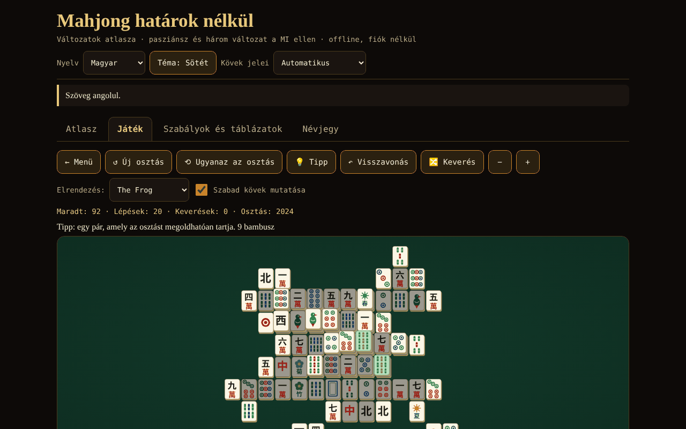

# Mahjong fără frontiere

[English](README.md) · [Română](README.ro.md) · [Français](README.fr.md) · [Italiano](README.it.md) · [Español](README.es.md) · [Português](README.pt.md) · [Deutsch](README.de.md) · **Magyar**

**Verzió:** 1.2.1 · **Utolsó frissítés:** 2026-10-19

A felület nyelvei: **Română, English, Français, Italiano, Español, Português (PT), Deutsch, Magyar**

Mahdzsong-változatok atlasza, garantáltan megoldható kiosztású szolitér, valamint 4 játékosos mahdzsong 3 MI ellen (riichi, hongkongi, szecsuáni) — egyetlen HTML-fájl, offline, fiók és hálózat nélkül.

**Élő:** https://chiuta.github.io/Mahjong-fara-frontiere/

## Mi ez

Egyetlen fájlból álló alkalmazás (`index.html`, ~263 KB) a „határok nélkül” sorozatból. Négy lapja van: **Atlasz** (kártyák 8 változatról), **Játék** (a játékok), **Szabályok és táblázatok** (a pontozási táblázatok közvetlenül a játék kódjából generálva) és **Névjegy**. A felület és az összes hosszú szöveg 8 nyelven érhető el (román, angol, francia, olasz, spanyol, portugál, német és magyar).

A „mahdzsong” gyűjtőfogalom. A „Shanghai” egy 1986-os szolitérjáték kereskedelmi neve; itt a játék neve „Mahdzsong szolitér” (kereskedelmi néven „Shanghai”); a címekben nem szerepel bejegyzett védjegy.

## Funkciók (a kódban és tesztekkel ellenőrizve)

- **Mahdzsong szolitér** 8, a szerző által rajzolt elrendezéssel (Lapos, Piramis, Kereszt, Béka, Sárkány, Fellegvár, Pillangó, Torony; 72–144 kő). Szabad kő = semmi sincs rajta ÉS a bal vagy a jobb oldala szabad. A virágok egymással, az évszakok egymással párosíthatók. A kiosztások **visszafelé** készülnek (az üres táblából), ezért megoldhatók; tipp (ellenőrizve vagy a generálási tanúsítvánnyal, amíg a megmaradt kövek még megfelelnek neki, vagy kis csomópont-költségvetésű megoldóval; egyébként „nem ellenőrzött” jelöléssel), korlátlan visszavonás, a megmaradt kövek keverése (továbbra is megoldható), reprodukálható kiosztásszám (seed), nagyítás, billentyűzet.
- **4 játékosos mahdzsong (te + 3 MI)** három változatban: **japán riichi**, **hongkongi** és **szecsuáni** (lásd az alábbi táblázatot). A felülettől elválasztott szabálymotor: húzás, dobás, pung/chow/kong (a szabályosságot a motor ellenőrzi), nyerés 4 szett + pár, 7 pár, 13 árva, pontozás, döntetlenek, az osztó forgása.
- **Riichi:** riichi, ippatsu, dora/ura-dora/aka, furiten (saját, ideiglenes, riichi után), kuikae, chankan, rinshan, 9 árva miatti félbeszakítás, különleges döntetlenek (négy szél, négy kan, négy riichi), nagashi mangan, tenpai-fizetés, honba és riichi-pálcikák; 42 bejegyzés a yaku/yakuman/bónusz táblázatban; fu és han → pontok.
- **Hongkong:** 136 vagy 144 kő, virágok és évszakok pótkövekkel, beállítható minimális faan (0–5), plafon (8/10/13), opcionális hét pár, két fizetési mód dobásnál.
- **Szecsuán:** 108 kő, hiányzó szín, nincs chow, többszörös nyerés („véres csata”, opcionális), kong hozzáadással csak közvetlenül a negyedik kő felhúzása után (MIL-szabály), a kongok azonnal fizetve, kimerüléskori büntetések.
- **Oktató MI** (heurisztikus: shanten, megmaradt kövek, védekezés; LLM nélkül). **Nem csal**: csak a nyilvános információból + a saját kezéből dönt; tesztelve. Kifejezett kivétel: a „Az MI kezeinek megmutatása (csak tanuláshoz)” opció.
- MI-tipp a lépésedhez (heurisztikaként jelölve, nem ítéletként), az MI sebessége, hossz (egy kéz / 4 / 8 forduló).
- Saját SVG-ben rajzolt kövek (körök, bambusz, karakterek 一…九, szelek 東南西北, sárkányok 中發白, virágok, évszakok), a hiányzó kínai glifák **automatikus felismerésével** és **latin betűs tartalékkal** (a fejlécből kézzel is kiválasztható).
- Sötét/világos téma, teljes billentyűzetkezelés (nyilak, Enter/Szóköz), bejelentések képernyőolvasókhoz, érintési célpontok ≥ 44 px, `prefers-reduced-motion`, 390 px vízszintes görgetés nélkül.
- Egyszerű statisztikák, helyben mentve, csak a böngésződben; a **Névjegy** lapon a „Helyi statisztikák törlése” gomb eltávolítja őket (megerősítéssel).
- **Szolitér-billentyűparancsok** (a táblán lévő fókusszal): `H` tipp, `U` vagy `Ctrl+Z` visszavonás, `S` keverés, a nyilak és az Enter/Szóköz mellett; a lista a tábla alatt jelenik meg, a 8 nyelven.
- **A szolitérjáték automatikusan mentődik** (minden lépés, visszavonás vagy keverés után), és a **Játék** lapról a „↻ Mentett játék folytatása” gombbal folytatható, a 8 nyelven. A mentést beolvasáskor ellenőrzi (létező elrendezés, teljes párok, következetes előzmények); a sérült adatokat figyelmen kívül hagyja. A „Helyi statisztikák törlése” a mentett játékot is törli.

## Változatok

| Változat | Játszható? | ⚠ Közelítések (röviden; a teljes lista az alkalmazásban) |
|---|---|---|
| Mahdzsong szolitér | igen | saját elrendezések; 144 kő alatt a párok egy részhalmazát használja; a megoldhatósági garancia a kiosztásra és a keverésekre vonatkozik, nem minden lépésre; a tipp csak tanúsítvánnyal vagy akkor ellenőrzött, ha a (kis költségvetésű) megoldó befejezi |
| Japán riichi | igen | nincs dupla/tripla ron (a legközelebbinek elsőbbség), nincs pao, renhou, chankan rejtett kanon, uma/oka és „sudden death”; renchan agari-yame nélkül; a kazoe yakuman aktív; nincsenek helyi yaku-k |
| Hongkong | igen | a faan → pont táblázat („half spicy”) és a fizetési módok dokumentált választás; hiányzik a dupla kongos nyerés és a 7 virággal való azonnali nyerés; dobásnál egyetlen nyertes |
| Szecsuán | igen | nincs 3 köves csere; a hiányzó szín nyilvános; a „virágmalac” 48-at fizet egyenlően elosztva (a forrás nem mondja meg, kinek); egyszerűsített büntetések |
| MCR (hivatalos kínai) | csak az atlaszban | — |
| Tajvani mahdzsong (16 kő) | csak az atlaszban | — |
| Amerikai mahdzsong | csak az atlaszban | az éves kártyát nem adja vissza |
| Sanma (3 játékos, Japán) | csak az atlaszban | — |

## Használati útmutató

1. Nyisd meg az `index.html` fájlt (vagy az Élő oldalt). Válaszd ki a nyelvet, a témát, és ha a kövek furcsán néznek ki, a „Kőszimbólumok” beállítást.
2. **Atlasz** lap: olvasd el a kártyákat (szabályok röviden, ami nem hű, források); a „▶ Játék” a játékhoz visz.
3. **Játék** lap: válaszd ki a játékot, állítsd be az opciókat (elrendezés / hossz / minimális faan stb., opcionális seed), és nyomd meg a „▶ Indítás” gombot.
4. **Szolitér:** nyomj meg két azonos szabad követ (vagy mozgasd a kurzort a nyilakkal, és nyomj Entert). A „Tipp” megjelöl egy párt; a „Visszavonás” visszalép; a „Keverés” újragenerálja a megmaradt pozíciókat, ha már nincs lépés.
5. **Az asztal MI-kkel:** amikor te jössz, nyomj meg egy követ a kezedben, hogy eldobd. Riichihez nyomd meg a „Riichi” gombot, majd egy megjelölt követ. Amikor egy MI olyan követ dob el, amely érdekel, megjelennek a Ron / Pung / Chow / Kong / Passz gombok. Az „MI-tipp” megmutatja, mit tenne az MI. A kéz végén látod a yaku-kat/faan-t/fan-t és a pontváltozásokat.
6. A **Szabályok és táblázatok** lap tartalmazza a yaku-, faan- és fan-táblázatokat pontosan úgy, ahogy a kódban vannak, a szószedetet és a kövek útmutatóját.

## Adatvédelem és hálózat

Semmi sem hagyja el a böngészőt: nincs fetch/XHR, nincs telemetria, nincsenek külső betűtípusok vagy szkriptek (CSP `default-src 'none'`, a szkript csak hash alapján engedélyezett). A `localStorage`-t használja (nyelv, téma, opciók, statisztikák, folyamatban lévő szolitérjáték) `try/catch` blokkban; az alkalmazás enélkül is működik. Az egyetlen külső hivatkozások a láblécben lévő Buy Me a Coffee támogatási gombok (`rel="noopener"`).

## Korlátok és figyelmeztetések

- **Nem teljes értékű versenytermék.** Minden változatnak vannak ⚠ közelítései (a fenti táblázat és az alkalmazás kártyái). A regionális szabályok eltérnek: Hongkongban a „half spicy” táblázatot és a dobáskori fizetést opcióként valósították meg; riichinél az „atamahane”-t (dobásnál egyetlen nyertes); Szecsuánban nincs kőcsere.
- **Az MI gyenge-közepes.** Nincsenek ellenfélmodelljei, a riichit nem játssza szakértői szinten támadóan/védekezően, és nem számít teljes valószínűségeket. Véletlen alapvonal ellen (változatonként 60 játék, az MI helye forgatva): kezenként ~52,8%-ot nyer riichinél, ~29,1%-ot Hongkongban (a véletlen alapvonalaknál szinte minden kéz döntetlen, a döntetlen pedig megismétli az osztót, így a játékok nagyon hosszúak; a mérték gyenge) és ~71,3%-ot Szecsuánban (paritás = 25%). Az MI-k között a játszmák nagyon agresszívak (a riichi-kezek ~89%-a nyeréssel végződik).
- Az összes hosszú szöveg (atlasz, szószedet, pontozási jegyzetek, a riichi/hongkongi/szecsuáni yaku-táblázatok, a 8 solitaire-elrendezés nevei és jegyzetei) és a felület le van fordítva mind a 8 nyelvre. Változatlanul marad: az atlaszlapok „src” mezője (Wikipedia-címek, hivatkozások) és a japán/kínai kifejezések (yaku japánul, riichi, dora stb.). A francia, olasz, spanyol, portugál, német és magyar fordítások automatikusak; a mahjong-terminológiát (főleg hu, de) érdemes anyanyelvi játékossal átnézetni.
- Hongkongban a döntetlen megtartja az osztót (szokásos szabály): magas minimális faan és passzív ellenfelek esetén a játék sokáig tarthat; csökkentsd a minimális faant, vagy válaszd az „egyetlen kéz” lehetőséget.
- Az „egyetlen kéz” az első kéz után állítja le a játékot (nem az osztóforgás után).
- A francia, olasz, spanyol, portugál, német és magyar fordításokat anyanyelvi beszélők ellenőrzése nélkül készítették.
- Kínai glifák nélküli betűtípusoknál automatikusan latin betűkre vált; ha a felismerés téved, használd a fejlécben lévő választót.

## Tesztek (a csomagon kívül: `scratchpad/new/games_work/Mahjong-fara-frontiere/`)

Összefoglaló; a parancsok és a teljes eredmények a `new/reports/Mahjong-fara-frontiere.md` jelentésben. A nyerő kezet (4 szett + pár, 7 pár, 13 árva) nyers erővel működő referencia-implementációval hasonlították össze több ezer kézen; a riichi pontozási táblázat (111 cella) és a Wikipédiából és a sloperamáról származó kidolgozott példák; a kövek számának invariánsa; változatonként ≥300 MI-MI játszma hiba nélkül; 1000 szolitér-kiosztás visszajátszva az üres tábláig; annak ellenőrzése, hogy az MI nem lát rejtett információt; a felület Playwright/Chromium-ellenőrzése (minden elrendezés, minden változat, 8 nyelv, 390 px).

## Független audit (összefoglaló)

Egy különálló audit (a motor szerzőjétől függetlenül írt kód és tesztek) javította: a rejtett/hozzáadásos kong felkínálása közvetlenül egy pung/chow után (felhúzott kő nélkül); Hongkongban a kizárólag figurákból álló „nagy szelek”/„négy négyzet” 13 faan helyett 10-et kapott; a szolitér „Tipp”-je néhány másodpercre lefagyaszthatta a felületet (most kis összköltségvetés); a sérült `localStorage`-adatok megakadályozhatták a játék indulását; Szecsuánban egy „elrabolt” kongkő (chankan) elveszettnek maradt a kézből; a román „sângele curge” felirat → „bătălia de sânge”. Továbbra is ellenőrizetlen: a megjelenítés Firefoxban/Safariban kínai betűtípusok nélkül (csak Chrome-ban tesztelve, CJK-betűtípusokkal és nélkülük) és a fr/it/es/pt/de fordítások anyanyelvi beszélők nélkül.

## Források

A megvalósításhoz és ellenőrzéshez felhasznált szabályok (Wikipédia-cikkek, szöveg másolása nélkül): „Mahjong”, „Mahjong solitaire”, „Japanese mahjong”, „Japanese mahjong yaku”, „Japanese mahjong scoring rules” (a pontozási táblázat és a kidolgozott példák), „Hong Kong mahjong”, „Sichuan mahjong”, „Mahjong Competition Rules”, „Taiwanese mahjong”, „American mahjong”; a fu-számítási példa (90 fu) a sloperama.com oldalról. A Wikipédia tartalmazhat hibákat vagy regionális eltéréseket; az atlasz kártyái megmondják, melyik változatot választották.

## Helyi futtatás

Nyisd meg az `index.html` fájlt böngészőben (szerver nélkül, telepítés nélkül). A forrásokból való újraépítéshez: `node build_site.js` a munkamappában (a szkript nem végez hálózati hívásokat).

## Licenc

MIT — lásd a `LICENSE` fájlt.

## Szerző

Alexio — Alexandru-Ionuț Chiuță · alexio@trom.tf

## Összefoglaló
A „Mahdzsong határok nélkül” egyetlen fájlba zárt, offline HTML-alkalmazás: nyolc mahdzsong-változat atlasza, egy mahdzsong szolitér nyolc saját rajzolású elrendezéssel és visszafelé szerkesztett (garantáltan megoldható) kiosztásokkal, valamint négyszemélyes mahdzsong három heurisztikus MI ellen három játszható változatban — japán riichi, hongkongi és szecsuáni. Az MCR, a tajvani, az amerikai és a háromszemélyes (sanma) csak az atlaszban szerepel. A köveket SVG-ben rajzolja, a kínai glifák hiányakor automatikus latin betűs tartalékkal. A felület román, angol, francia, olasz, spanyol, portugál, német és magyar nyelvű; az összes hosszú szöveg (atlasz, szószedet, pontozási jegyzetek) is le van fordítva. Az MI nem csal (csak a nyilvános információt és a saját kezét látja; a kifejezett tanulási opció, az „MI kezeinek megmutatása” az egyetlen kivétel). Minden szabályközelítés ⚠ jelöléssel szerepel az alkalmazásban és a fenti táblázatban. Hálózati hozzáférés és követés nélkül; szigorú CSP. Licenc: MIT (lásd LICENSE).

## Új funkciók (v1.1.0)

- **Hálózati szolitér-párbaj** („Hálózati párbaj (ugyanaz a tábla)”): mindkét játékos ugyanazt a táblát kapja (azonos seed és elrendezés), és párhuzamosan old; mindegyik látja a másik előrehaladását, a végén pedig összehasonlítják az eredményeket. A párbajban a tippek, az új játék és a folytatás ki vannak kapcsolva, a helyi mentést pedig nem érinti. Ez nem négyszemélyes mahdzsong: ennyit enged őszintén a szolitér. A kapcsolat közvetlenül a két böngésző között jön létre (WebRTC), a mi szerverünk nélkül: két szöveget (ajánlat/válasz) cserélsz, szövegként vagy QR-kódként, bármely általad választott csatornán. Alapértelmezés szerint nem veszi fel a kapcsolatot egyetlen STUN-szerverrel sem; egy kézzel megadható a csatlakozási ablakban, csak ha akarod. Ha a kapcsolat megszakad, az alkalmazás jelzi, és a lépésnaplóból folytathatja a játékot.
- **Az atlasz kártyáinak felolvasása** („Meghallgatás” gomb, FFF.tts).
- Közös készlet (core, label, bundle, qr, p2p, tts).
- Az új szövegek az alkalmazás minden nyelvén megvannak (beleértve a hu/de nyelvet, ahol van i18n rendszer); az automatikus fordításokat anyanyelvi beszélők nem ellenőrizték.
- Tesztek: `tests/fff-r8.test.mjs` (blokkolt hálózat, két, a valódi párbeszédpanelen át összekapcsolt környezet, axe 0 hiba 1280 és 360 px szélességnél).

## Előzmények / Changelog

### 2026-10-19 (v1.2.1)
- Az összes hosszú szöveg (a 8 változat atlasza, szószedet, pontozási jegyzetek, kb. 90 yaku-bejegyzés, a 8 solitaire-elrendezés) le van fordítva fr, it, es, pt, de, hu nyelvre; a „szöveg angolul” megjegyzés már nem jelenik meg. Automatikus fordítások, anyanyelvi beszélők nem ellenőrizték.

### 2026. október 14. (v1.1.0)
- Új: hálózati szolitér-párbaj (ugyanaz a tábla), a kártyák felolvasása, közös készlet, tesztek.

- 1.0.0 — 2026-10-12: a verzió és az utolsó frissítés dátuma megjelenik az alkalmazásban
- **2026. október 11.** (7. kör) — a szolitérjáték automatikus mentése és folytatása (ellenőrzött, 7 nyelv, belefoglalva az adatvédelmi szövegbe); böngészőben tesztelve (lépés → újratöltés → folytatás ugyanannyi kővel; sérült mentés figyelmen kívül hagyva); 0 hiba, axe 0 hiba 1280×800 és 360×740 méretnél.
- **2026. október 11.** — billentyűparancsok a szolitérhez (H / U vagy Ctrl+Z / S) magyarázattal a tábla alatt, „Helyi statisztikák törlése” gomb a Névjegy lapon (szövegek 7 nyelven); a szkript CSP-hash-e újraszámolva; tesztelve (0 hiba, 0 CSP-sértés, axe-core 0 hiba 1280×800 és 360×740 méretnél).
- **2026. október 11.** — az asztalnál megjelenő üzenet már nem azt mondja, hogy „You is thinking…” (amikor a formális sor a tiéd, de a műveletet a többiek oldják fel, „Várakozás a többi játékosra…” jelenik meg, mind a 7 nyelven); a szolitér „Lépések” számlálója már nem nullázódik keveréskor (saját számlálója van, amely keveréskor megmarad, visszavonáskor csökken).
- Akadálymentesség: a lapsáv egy `nav`-ban van külön `tablist`-tel, az Atlasz-kártyák címei `h2` elemek (helyes címsorrend), a támogatási widget `complementary` szerepet kapott; axe-core: 0 hiba 1280×800 és 360×740 méretnél. A szkript CSP-hash-e újra lett számolva. Az alkalmazásnak nincs verziószáma.
