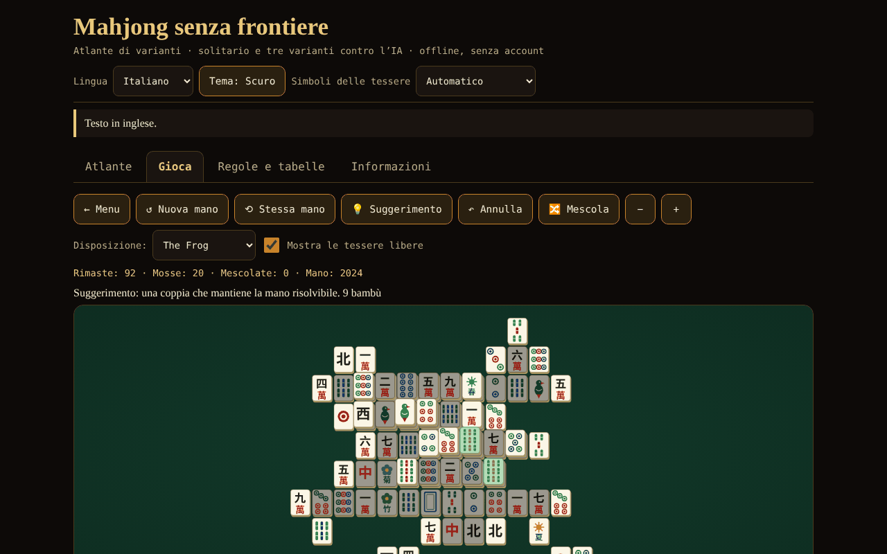

# Mahjong fără frontiere

[English](README.md) · [Română](README.ro.md) · [Français](README.fr.md) · **Italiano** · [Español](README.es.md) · [Português](README.pt.md) · [Deutsch](README.de.md) · [Magyar](README.hu.md)

**Versione:** 1.2.0 · **Ultimo aggiornamento:** 2026-10-19

Lingue dell'interfaccia: **Română, English, Français, Italiano, Español, Português (PT), Deutsch, Magyar**

Atlante di varianti del mahjong, solitario con distribuzioni garantite risolvibili e mahjong a 4 giocatori contro 3 IA (riichi, Hong Kong, Sichuan) — un unico file HTML, offline, senza account e senza rete.

**Online:** https://chiuta.github.io/Mahjong-fara-frontiere/

## Che cos'è

Un'app in un unico file (`index.html`, ~263 KB) della serie «senza frontiere». Ha quattro schede: **Atlante** (schede su 8 varianti), **Gioca** (i giochi), **Regole e tabelle** (le tabelle dei punteggi generate direttamente dal codice del gioco) e **Informazioni**. L'interfaccia è in rumeno e, a scelta, in inglese, francese, italiano, spagnolo, portoghese, tedesco e ungherese.

«Mahjong» è un termine generico. «Shanghai» è il nome commerciale di un gioco di solitario del 1986; qui il gioco si chiama «Mahjong solitario» (noto commercialmente come «Shanghai»); nessun marchio registrato compare nei titoli.

## Funzioni (verificate nel codice e con test)

- **Mahjong solitario** con 8 disposizioni disegnate dall'autore (Piatta, Piramide, Croce, Rana, Drago, Cittadella, Farfalla, Torre; 72–144 tessere). Tessera libera = niente sopra E lato sinistro o destro libero. I fiori si abbinano tra loro, le stagioni tra loro. Le distribuzioni sono generate **al contrario** (dal tavolo vuoto), quindi sono risolvibili; suggerimento (verificato o dal certificato di generazione, finché le tessere rimaste lo rispettano, o con un solver a basso budget di nodi; altrimenti contrassegnato «non verificato»), annullamento illimitato, rimescolamento delle tessere rimaste (sempre risolvibile), numero di distribuzione (seed) riproducibile, zoom, tastiera.
- **Mahjong a 4 giocatori (tu + 3 IA)** in tre varianti: **riichi giapponese**, **Hong Kong** e **Sichuan** (vedi la tabella sotto). Motore di regole separato dall'interfaccia: pesca, scarto, pung/chow/kong (con legalità verificata dal motore), vittoria 4 gruppi + coppia, 7 coppie, 13 orfani, punteggio, patte, rotazione del mazziere.
- **Riichi:** riichi, ippatsu, dora/ura-dora/aka, furiten (proprio, temporaneo, dopo il riichi), kuikae, chankan, rinshan, abbandono per 9 orfani, patte speciali (quattro venti, quattro kan, quattro riichi), nagashi mangan, pagamento del tenpai, honba e bastoncini riichi; 42 voci nella tabella di yaku/yakuman/bonus; fu e han → punti.
- **Hong Kong:** 136 o 144 tessere, fiori e stagioni con tessere di sostituzione, faan minimo configurabile (0–5), limite (8/10/13), sette coppie facoltative, due modalità di pagamento allo scarto.
- **Sichuan:** 108 tessere, seme mancante, niente chow, vittorie multiple («battaglia di sangue», facoltativa), kong per aggiunta solo subito dopo aver pescato la quarta tessera (regola MIL), kong pagati subito, penalità all'esaurimento.
- **IA didattica** (euristica: shanten, tessere rimaste, difesa; senza LLM). **Non bara**: decide solo dalle informazioni pubbliche + la propria mano; testato. Eccezione esplicita: l'opzione «Mostra le mani dell'IA (solo per imparare)».
- Suggerimento dell'IA per la tua mossa (segnalato come euristica, non come verdetto), velocità dell'IA, durata (una mano / 4 / 8 rotazioni).
- Tessere disegnate in SVG proprio (cerchi, bambù, caratteri 一…九, venti 東南西北, draghi 中發白, fiori, stagioni), con **rilevamento automatico** dell'assenza di glifi cinesi e **alternativa con lettere latine** (si può scegliere anche manualmente dall'intestazione).
- Tema scuro/chiaro, tastiera completa (frecce, Invio/Spazio), annunci per lettori di schermo, aree tattili ≥ 44 px, `prefers-reduced-motion`, 390 px senza scorrimento orizzontale.
- Statistiche semplici, salvate in locale, solo nel tuo browser; nella scheda **Informazioni** il pulsante «Cancella le statistiche locali» le elimina (con conferma).
- **Scorciatoie nel solitario** (con il focus sul tavolo): `H` suggerimento, `U` o `Ctrl+Z` annulla, `S` rimescola, oltre alle frecce e a Invio/Spazio; l'elenco compare sotto il tavolo, nelle 8 lingue.
- **La partita di solitario viene salvata automaticamente** (dopo ogni mossa, annullamento o rimescolamento) e può essere ripresa dalla scheda **Gioca** con il pulsante «↻ Continua la partita salvata», nelle 8 lingue. Il salvataggio viene convalidato alla lettura (disposizione esistente, coppie complete, cronologia coerente); i dati corrotti vengono ignorati. «Cancella le statistiche locali» cancella anche la partita salvata.

## Varianti

| Variante | Giocabile? | ⚠ Approssimazioni (in breve; elenco completo nell'app) |
|---|---|---|
| Mahjong solitario | sì | disposizioni proprie; sotto le 144 tessere si usa un sottoinsieme di coppie; la garanzia di risolvibilità vale per la distribuzione e i rimescolamenti, non per qualsiasi mossa; il suggerimento è verificato solo da certificato o quando il solver (a basso budget) termina |
| Riichi giapponese | sì | niente ron doppio/triplo (priorità al più vicino), niente pao, renhou, chankan su kan nascosto, uma/oka e «sudden death»; renchan senza agari-yame; kazoe yakuman attivo; niente yaku locali |
| Hong Kong | sì | la tabella faan → punti («half spicy») e le modalità di pagamento sono una scelta documentata; mancano la vittoria con doppio kong e quella istantanea con 7 fiori; un solo vincitore allo scarto |
| Sichuan | sì | niente scambio di 3 tessere; il seme mancante è pubblico; il «maiale dei fiori» paga 48 divisi in parti uguali (la fonte non dice a chi); penalità semplificate |
| MCR (ufficiale cinese) | solo nell'atlante | — |
| Mahjong taiwanese (16 tessere) | solo nell'atlante | — |
| Mahjong americano | solo nell'atlante | la carta annuale non è riprodotta |
| Sanma (3 giocatori, Giappone) | solo nell'atlante | — |

## Guida all'uso

1. Apri `index.html` (o la pagina Online). Scegli la lingua, il tema e, se le tessere appaiono strane, «Simboli delle tessere».
2. Scheda **Atlante**: leggi le schede (regole in breve, ciò che non è fedele, fonti); «▶ Gioca» porta al gioco.
3. Scheda **Gioca**: scegli il gioco, imposta le opzioni (disposizione / durata / faan minimo ecc., seed facoltativo) e premi «▶ Inizia».
4. **Solitario:** premi due tessere libere identiche (oppure sposta il cursore con le frecce e premi Invio). «Suggerimento» segna una coppia; «Annulla» torna indietro; «Rimescola» rigenera le posizioni rimaste quando non ci sono più mosse.
5. **Il tavolo con le IA:** quando è il tuo turno, premi una tessera della mano per scartarla. Per il riichi premi «Riichi», poi una tessera segnata. Quando un'IA scarta una tessera che ti interessa compaiono i pulsanti Ron / Pung / Chow / Kong / Passa. «Suggerimento IA» mostra cosa farebbe l'IA. A fine mano vedi yaku/faan/fan e le variazioni di punteggio.
6. La scheda **Regole e tabelle** contiene le tabelle di yaku, faan e fan esattamente come nel codice, il glossario e la guida alle tessere.

## Privacy e rete

Nulla esce dal browser: niente fetch/XHR, niente telemetria, niente font o script esterni (CSP `default-src 'none'`, script consentito solo tramite hash). Si usa `localStorage` (lingua, tema, opzioni, statistiche, partita di solitario in corso) in `try/catch`; l'app funziona anche senza. Gli unici link esterni sono i pulsanti di sostegno Buy Me a Coffee nel piè di pagina (`rel="noopener"`).

## Limiti e avvertenze

- **Non è un prodotto da competizione completo.** Ogni variante ha approssimazioni ⚠ (la tabella sopra e le schede nell'app). Le regole regionali differiscono: a Hong Kong è stata implementata la tabella «half spicy» e il pagamento allo scarto come opzione; nel riichi, «atamahane» (un solo vincitore allo scarto); nel Sichuan, niente scambio di tessere.
- **L'IA è di livello debole-medio.** Non ha modelli dell'avversario, non gioca il riichi offensivo/difensivo a livello esperto e non calcola probabilità complete. Contro una base casuale (60 partite per variante, posto dell'IA ruotato): vince per mano ~52,8% nel riichi, ~29,1% a Hong Kong (con le basi casuali quasi tutte le mani sono patte, e la patta ripete il mazziere, quindi le partite sono molto lunghe; la misura è debole) e ~71,3% nel Sichuan (parità = 25%). Tra IA le partite sono molto aggressive (~89% delle mani di riichi finisce con una vittoria).
- I testi lunghi (atlante, glossario, note sul punteggio) esistono solo in **rumeno e inglese**; nelle altre 6 lingue il testo è mostrato in inglese, con una nota discreta («testo in inglese»). Gli elementi dell'interfaccia sono tradotti in tutte le 8 lingue (parità verificata da script).
- A Hong Kong, la patta mantiene il mazziere (regola abituale): con un faan minimo alto e avversari passivi la partita può durare a lungo; abbassa il faan minimo o scegli «una sola mano».
- «Una sola mano» ferma il gioco dopo la prima mano (non dopo la rotazione del mazziere).
- Le traduzioni in francese, italiano, spagnolo, portoghese, tedesco e ungherese sono state fatte senza verifica da parte di madrelingua.
- Con font privi di glifi cinesi si passa automaticamente alle lettere latine; se il rilevamento sbaglia, usa il selettore dell'intestazione.

## Test (fuori dal pacchetto: `scratchpad/new/games_work/Mahjong-fara-frontiere/`)

Riepilogo; comandi e risultati completi nel rapporto `new/reports/Mahjong-fara-frontiere.md`. Mano vincente (4 gruppi + coppia, 7 coppie, 13 orfani) confrontata con un'implementazione di riferimento a forza bruta su migliaia di mani; tabella dei punti del riichi (111 celle) ed esempi svolti da Wikipedia e sloperama; invariante del numero di tessere; ≥300 partite IA contro IA per variante senza errori; 1000 distribuzioni di solitario rigiocate fino al tavolo vuoto; verifica che l'IA non veda informazioni nascoste; verifica Playwright/Chromium dell'interfaccia (tutte le disposizioni, tutte le varianti, 8 lingue, 390 px).

## Audit indipendente (riepilogo)

Un audit separato (codice e test scritti indipendentemente dall'autore del motore) ha corretto: kong nascosto/per aggiunta offerto subito dopo un pung/chow (senza tessera pescata); a Hong Kong, «grandi venti»/«quattro quadrati» formati solo da onori erano conteggiati 10 invece di 13 faan; il «Suggerimento» del solitario poteva bloccare l'interfaccia per qualche secondo (ora un piccolo budget totale); dati corrotti di `localStorage` potevano impedire l'avvio del gioco; nel Sichuan, una tessera di kong «rubata» (chankan) restava persa dalla mano; etichetta rumena «sângele curge» → «bătălia de sânge». Restano non verificati: il rendering in Firefox/Safari senza font cinesi (testato solo in Chromium, con e senza font CJK) e le traduzioni fr/it/es/pt/de senza madrelingua.

## Fonti

Regole consultate per l'implementazione e la verifica (articoli di Wikipedia, senza copiare testo): «Mahjong», «Mahjong solitaire», «Japanese mahjong», «Japanese mahjong yaku», «Japanese mahjong scoring rules» (la tabella dei punti e gli esempi svolti), «Hong Kong mahjong», «Sichuan mahjong», «Mahjong Competition Rules», «Taiwanese mahjong», «American mahjong»; l'esempio di calcolo del fu (90 fu) da sloperama.com. Wikipedia può contenere errori o differenze regionali; le schede dell'atlante dicono quale variante è stata scelta.

## Esecuzione locale

Apri `index.html` in un browser (senza server, senza installazione). Per ricostruire dai sorgenti: `node build_site.js` nella cartella di lavoro (lo script non effettua chiamate di rete).

## Licenza

MIT — vedi il file `LICENSE`.

## Autore

Alexio — Alexandru-Ionuț Chiuță · alexio@trom.tf

## Riepilogo in inglese

«Mahjong senza frontiere» è un'app HTML in un unico file, offline: un atlante di otto varianti del mahjong, un mahjong solitario con otto disposizioni disegnate dall'autore e distribuzioni costruite al contrario (garantite risolvibili), e un mahjong a quattro posti contro tre IA euristiche in tre varianti giocabili — riichi giapponese, Hong Kong e Sichuan. MCR, taiwanese, americano e a tre giocatori (sanma) sono solo nell'atlante. Le tessere sono disegnate in SVG con un'alternativa automatica in lettere latine quando mancano i glifi cinesi. L'interfaccia è in rumeno, inglese, francese, italiano, spagnolo, portoghese, tedesco e ungherese; i testi lunghi (atlante, glossario, note sul punteggio) esistono solo in rumeno e inglese e sono mostrati in inglese, con una piccola nota, nelle altre lingue. L'IA non bara (vede solo le informazioni pubbliche e la propria mano; un'opzione esplicita di apprendimento «mostra le mani dell'IA» è l'unica eccezione). Ogni approssimazione delle regole è segnalata con ⚠ nell'app e nella tabella sopra. Nessun accesso alla rete, nessun tracciamento; CSP rigorosa. Licenza: MIT (vedi LICENSE).

## Nuove funzioni (v1.1.0)

- **Duello di solitario in rete** («Duello in rete (stesso tavolo)»): entrambi i giocatori ricevono lo stesso tavolo (stesso seed e stessa disposizione) e risolvono in parallelo; ciascuno vede i progressi dell'altro, e alla fine si confrontano i risultati. Nel duello sono disattivati i suggerimenti, la nuova partita e la ripresa, e il salvataggio locale non viene toccato. Non è Mahjong a quattro giocatori: tanto permette onestamente il solitario. La connessione avviene direttamente tra i due browser (WebRTC), senza un nostro server: scambi due testi (offerta/risposta), come testo o codice QR, attraverso qualsiasi canale scelto da te. Per impostazione predefinita non viene contattato alcun server STUN; se ne può inserire uno manualmente nella finestra di connessione, solo se lo vuoi. Se il collegamento si interrompe, l'app lo mostra e può riprendere la partita dal registro delle mosse.
- **Lettura ad alta voce delle schede dell'atlante** (pulsante «Ascolta», FFF.tts).
- Kit comune (core, label, bundle, qr, p2p, tts).
- I nuovi testi sono in tutte le lingue dell'app (compresi hu/de dove esiste un sistema i18n); le traduzioni automatiche non sono verificate da madrelingua.
- Test: `tests/fff-r8.test.mjs` (rete bloccata, due contesti connessi tramite la finestra reale, axe 0 violazioni a 1280 e 360 px).

## Cronologia / Changelog

### 14 ottobre 2026 (v1.1.0)
- Novità: duello di solitario in rete (stesso tavolo), lettura ad alta voce delle schede, kit comune, test.

- 1.0.0 — 2026-10-12: la versione e la data dell'ultimo aggiornamento sono mostrate nell'app
- **11 ottobre 2026** (turno 7) — salvataggio automatico e ripresa della partita di solitario (convalidati, 7 lingue, inclusi nel testo sulla privacy); testato nel browser (mossa → ricaricamento → ripresa con lo stesso numero di tessere; salvataggio corrotto ignorato); 0 errori, axe 0 violazioni a 1280×800 e 360×740.
- **11 ottobre 2026** — scorciatoie da tastiera nel solitario (H / U o Ctrl+Z / S) con spiegazione sotto il tavolo, pulsante «Cancella le statistiche locali» in Informazioni (testi in 7 lingue); hash CSP dello script ricalcolato; testato (0 errori, 0 violazioni CSP, axe-core 0 violazioni a 1280×800 e 360×740).
- **11 ottobre 2026** — il messaggio al tavolo non dice più «You is thinking…» (quando il turno formale è tuo ma l'azione è risolta dagli altri, compare «In attesa degli altri giocatori…», in tutte le 7 lingue); il contatore «Mosse» del solitario non si azzera più al rimescolamento (ha un contatore proprio, mantenuto al rimescolamento, diminuito all'annullamento).
- Accessibilità: la barra delle schede è in un `nav` con un `tablist` separato, i titoli delle schede dell'Atlante sono `h2` (ordine corretto dei titoli), il widget di sostegno ha il ruolo `complementary`; axe-core: 0 violazioni a 1280×800 e 360×740. L'hash CSP dello script è stato ricalcolato. L'app non ha un numero di versione.
