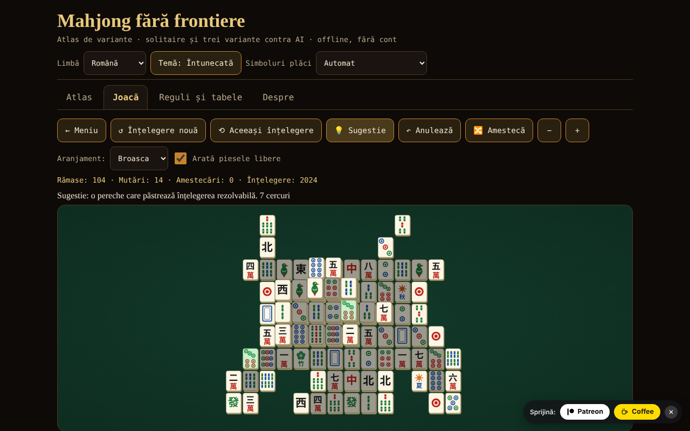

# Mahjong fără frontiere

Atlas de variante de mahjong, solitaire cu înțelegeri garantat rezolvabile și mahjong cu 4 jucători contra 3 AI (riichi, Hong Kong, Sichuan) — un singur fișier HTML, offline, fără cont și fără rețea.

**Live:** https://chiuta.github.io/Mahjong-fara-frontiere/

## Ce este

O aplicație dintr-un singur fișier (`index.html`, ~250 KB) din seria „fără frontiere”. Are patru file: **Atlas** (fișe despre 8 variante), **Joacă** (jocurile), **Reguli și tabele** (tabelele de scor generate chiar din codul jocului) și **Despre**. Interfața este în română și, la alegere, în engleză, franceză, italiană, spaniolă, portugheză și germană.

„Mahjong” este un termen generic. „Shanghai” este denumirea comercială a unui joc de solitaire din 1986; aici jocul se numește „Mahjong solitaire” (cunoscut comercial ca „Shanghai”); nicio marcă înregistrată nu apare în titluri.

## Funcții (verificate în cod și prin teste)

- **Mahjong solitaire** cu 8 aranjamente desenate de autor (Plat, Piramidă, Cruce, Broasca, Dragon, Cetate, Fluture, Turn; 72–144 de plăci). Piesă liberă = nimic deasupra ȘI stânga sau dreapta liberă. Florile se potrivesc între ele, anotimpurile între ele. Înțelegerile sunt generate **invers** (din tabla goală), deci sunt rezolvabile; sugestie (verificată fie prin certificatul de generare, când piesele rămase îl mai respectă, fie cu un solver cu buget mic de noduri; altfel marcată „neverificată”), anulare nelimitată, amestecare a pieselor rămase (tot rezolvabilă), număr de înțelegere (seed) reproductibil, zoom, tastatură.
- **Mahjong cu 4 jucători (tu + 3 AI)** în trei variante: **riichi japonez**, **Hong Kong** și **Sichuan** (vezi tabelul de mai jos). Motor de reguli separat de interfață: tragere, aruncare, pung/chow/kong (cu legalitate verificată de motor), câștig 4 seturi + pereche, 7 perechi, 13 orfani, scorare, remize, rotația dealerului.
- **Riichi:** riichi, ippatsu, dora/ura-dora/aka, furiten (propriu, temporar, după riichi), kuikae, chankan, rinshan, abandon 9 orfani, remize speciale (patru vânturi, patru kan-uri, patru riichi), nagashi mangan, plata tenpai, honba și bețe riichi; 42 de intrări în tabelul de yaku/yakuman/bonusuri; fu și han → puncte.
- **Hong Kong:** 136 sau 144 de plăci, flori și anotimpuri cu piese de înlocuire, faan minim configurabil (0–5), plafon (8/10/13), șapte perechi opțional, două moduri de plată la aruncare.
- **Sichuan:** 108 plăci, culoare lipsă, fără chow, câștiguri multiple („bătălia de sânge”, opțional), kong prin adăugare doar imediat după tragerea celei de-a patra piese (regula MIL), kong-uri plătite imediat, penalizări la epuizare.
- **AI didactic** (euristic: shanten, piese rămase, apărare; fără LLM). **Nu trișează**: decide doar din informația publică + propria mână; testat. Excepție explicită: opțiunea „Arată mâinile AI (doar pentru învățare)”.
- Sugestie AI pentru mutarea ta (marcată ca euristică, nu verdict), viteza AI, durată (o mână / 4 / 8 rotații).
- Plăci desenate în SVG propriu (cercuri, bambus, caractere 一…九, vânturi 東南西北, dragoni 中發白, flori, anotimpuri), cu **detectare automată** a lipsei glifelor chinezești și **alternativă cu litere latine** (se poate alege și manual din antet).
- Temă întunecată/luminoasă, tastatură completă (săgeți, Enter/Spațiu), anunțuri pentru cititoare de ecran, țintele tactile ≥ 44 px, `prefers-reduced-motion`, 390 px fără derulare orizontală.
- Statistici simple, salvate local, doar în browserul tău.

## Variante

| Variantă | Jucabilă? | ⚠ Aproximări (pe scurt; lista completă în aplicație) |
|---|---|---|
| Mahjong solitaire | da | aranjamente proprii; sub 144 de plăci se folosește un subset de perechi; garanția de rezolvabilitate e pentru înțelegere și amestecări, nu pentru orice mutare; sugestia e verificată doar prin certificat sau când solverul (buget mic) termină |
| Riichi japonez | da | fără ron dublu/triplu (prioritate celui mai apropiat), fără pao, renhou, chankan pe kan ascuns, uma/oka și „sudden death”; renchan fără agari-yame; kazoe yakuman activ; fără yaku locale |
| Hong Kong | da | tabelul faan → puncte („half spicy”) și modurile de plată sunt alegerea documentată; lipsesc câștigul cu dublu kong și cel instant cu 7 flori; un singur câștigător la aruncare |
| Sichuan | da | fără schimbul de 3 plăci; culoarea lipsă e publică; „porcul de floare” plătește 48 împărțit egal (sursa nu spune cui); penalizări simplificate |
| MCR (oficial chinez) | doar în atlas | — |
| Mahjong taiwanez (16 plăci) | doar în atlas | — |
| Mahjong american | doar în atlas | cardul anual nu e reprodus |
| Sanma (3 jucători, Japonia) | doar în atlas | — |

## Manual de utilizare

1. Deschide `index.html` (sau pagina Live). Alege limba, tema și, dacă plăcile arată ciudat, „Simboluri plăci”.
2. Fila **Atlas**: citește fișele (reguli în scurt, ce nu e fidel, surse); „▶ Joacă” duce la joc.
3. Fila **Joacă**: alege jocul, setează opțiunile (aranjament / durată / faan minim etc., seed opțional) și apasă „▶ Începe”.
4. **Solitaire:** apasă două plăci libere identice (sau mută cursorul cu săgețile și apasă Enter). „Sugestie” marchează o pereche; „Anulează” revine; „Amestecă” regenerează pozițiile rămase când nu mai sunt mutări.
5. **Masa cu AI:** când e rândul tău, apasă o piesă din mână pentru a o arunca. Pentru riichi apasă „Riichi”, apoi o piesă marcată. Când un AI aruncă o piesă care te interesează apar butoanele Ron / Pung / Chow / Kong / Pas. „Sugestie AI” arată ce ar face AI-ul. La final de mână vezi yaku/faan/fan și schimbările de scor.
6. Fila **Reguli și tabele** conține tabelele de yaku, faan și fan exact așa cum sunt în cod, glosarul și ghidul plăcilor.

## Confidențialitate și rețea

Nimic nu pleacă din browser: fără fetch/XHR, fără telemetrie, fără fonturi sau scripturi externe (CSP `default-src 'none'`, script permis doar prin hash). Se folosește `localStorage` (limbă, temă, opțiuni, statistici) în `try/catch`; aplicația merge și fără el. Singurele legături externe sunt butoanele de sprijin Patreon / Buy Me a Coffee din subsol (`rel="noopener"`).

## Limite și avertismente

- **Nu este un produs complet de competiție.** Fiecare variantă are aproximări ⚠ (tabelul de mai sus și fișele din aplicație). Reguli regionale diferă: la Hong Kong s-a implementat tabelul „half spicy” și plata la aruncare ca opțiune; la riichi, „atamahane” (un singur câștigător la aruncare); la Sichuan, fără schimbul de plăci.
- **AI-ul este slab-spre-mediu.** Nu are modele de adversar, nu joacă riichi-ul ofensiv/defensiv la nivel de expert și nu calculează probabilități complete. Contra unei baze aleatoare (60 de jocuri pe variantă, locul AI-ului rotit): câștigă pe mână ~52,8% la riichi, ~29,1% la Hong Kong (cu bazele aleatoare aproape toate mâinile sunt remize, iar remiza repetă dealerul, deci jocurile sunt foarte lungi; măsura e slabă) și ~71,3% la Sichuan (paritate = 25%). Între AI-uri partidele sunt foarte agresive (~89% din mâinile de riichi se termină cu câștig).
- Textele lungi (atlas, glosar, notele de scor) există doar în **română și engleză**; în celelalte 5 limbi se afișează textul în engleză, cu o notă discretă („text în engleză”). Elementele de interfață sunt traduse în toate cele 7 limbi (paritate verificată de script).
- La Hong Kong, remiza păstrează dealerul (regulă obișnuită): cu un faan minim mare și adversari pasivi jocul poate dura mult; coboară faan-ul minim sau alege „o singură mână”.
- „O singură mână” oprește jocul după prima mână (nu după rotația dealerului).
- Traducerile din franceză, italiană, spaniolă, portugheză și germană sunt făcute fără verificare de către vorbitori nativi.
- Cu fonturi fără glife chinezești se trece automat pe litere latine; dacă detecția greșește, folosește selectorul din antet.

## Teste (în afara pachetului: `scratchpad/new/games_work/Mahjong-fara-frontiere/`)

Rezumat; comenzi și rezultate complete în raportul `new/reports/Mahjong-fara-frontiere.md`. Mâna câștigătoare (4 seturi + pereche, 7 perechi, 13 orfani) comparată cu o implementare de referință prin forță brută pe mii de mâini; tabelul de puncte riichi (111 celule) și exemple lucrate din Wikipedia și sloperama; invariantul numărului de plăci; ≥300 de partide AI contra AI per variantă fără erori; 1000 de înțelegeri solitaire reluate până la tabla goală; verificare că AI-ul nu vede informație ascunsă; verificare Playwright/Chromium a interfeței (toate aranjamentele, toate variantele, 7 limbi, 390 px).

## Audit independent (rezumat)

Un audit separat (cod și teste scrise independent de autorul motorului) a corectat: kong ascuns/prin adăugare oferit imediat după pung/chow (fără piesă trasă); la Hong Kong „vânturi mari”/„patru careuri” formate doar din onori erau punctate 10 în loc de 13 faan; „Sugestie” din solitaire putea îngheța interfața câteva secunde (acum buget total mic); date corupte din `localStorage` puteau opri pornirea jocului; la Sichuan, o piesă de kong „furată” (chankan) rămânea pierdută din mână; etichetă română „sângele curge” → „bătălia de sânge”. Rămân neverificate: randarea în Firefox/Safari fără fonturi chinezești (testat doar în Chromium, cu și fără fonturi CJK) și traducerile fr/it/es/pt/de fără vorbitori nativi.

## Surse

Reguli consultate pentru implementare și verificare (articole Wikipedia, fără copiere de text): „Mahjong”, „Mahjong solitaire”, „Japanese mahjong”, „Japanese mahjong yaku”, „Japanese mahjong scoring rules” (tabelul de puncte și exemplele lucrate), „Hong Kong mahjong”, „Sichuan mahjong”, „Mahjong Competition Rules”, „Taiwanese mahjong”, „American mahjong”; exemplul de calcul al fu-ului (90 fu) de pe sloperama.com. Wikipedia poate conține erori sau diferențe regionale; fișele din atlas spun ce variantă s-a ales.

## Rulare locală

Deschide `index.html` într-un browser (fără server, fără instalare). Pentru a reconstrui din surse: `node build_site.js` în folderul de lucru (scriptul nu face apeluri de rețea).

## Licență

Nedeclarată — decizia autorului.

## Autor

Alexio — Alexandru-Ionuț Chiuță · alexio@trom.tf

## English summary

“Mahjong without borders” is a single-file, offline HTML app: an atlas of eight mahjong variants, a mahjong solitaire with eight self-drawn layouts and reverse-constructed (guaranteed solvable) deals, and four-seat mahjong against three heuristic AIs in three playable variants — Japanese riichi, Hong Kong and Sichuan. MCR, Taiwanese, American and three-player (sanma) are atlas-only. Tiles are drawn as SVG with an automatic Latin-letter fallback when Chinese glyphs are missing. The UI is in Romanian, English, French, Italian, Spanish, Portuguese and German; long texts (atlas, glossary, scoring notes) exist only in Romanian and English and are shown in English, with a small note, in the other languages. The AI does not cheat (it sees only public information and its own hand; an explicit “show AI hands” learning option is the only exception). Every rule approximation is marked ⚠ in the app and in the table above. No network access, no tracking; strict CSP. License: not declared — the author’s decision.
