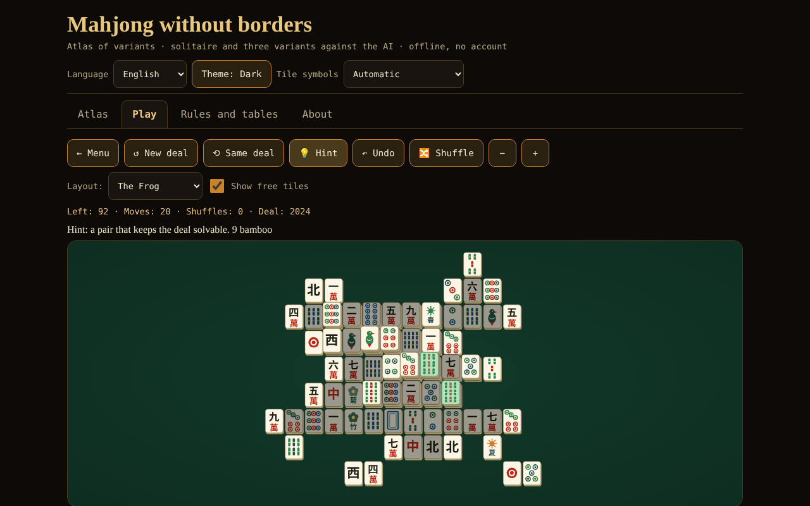

# Mahjong fără frontiere

**English** · [Română](README.ro.md) · [Français](README.fr.md) · [Italiano](README.it.md) · [Español](README.es.md) · [Português](README.pt.md) · [Deutsch](README.de.md) · [Magyar](README.hu.md)

**Version:** 1.2.2 · **Last updated:** 2026-10-22

Interface languages: **Română, English, Français, Italiano, Español, Português (PT), Deutsch, Magyar**

An atlas of mahjong variants, mahjong solitaire with guaranteed-solvable deals, and 4-player mahjong against 3 AIs (riichi, Hong Kong, Sichuan) — a single HTML file, offline, with no account and no network.

**Live:** https://chiuta.github.io/Mahjong-fara-frontiere/

## What it is

A single-file app (`index.html`, ~263 KB) from the "without borders" series. It has four tabs: **Atlas** (cards on 8 variants), **Play** (the games), **Rules and tables** (the scoring tables generated straight from the game's code) and **About**. The interface and all the long texts are in 8 languages (Romanian, English, French, Italian, Spanish, Portuguese, German and Hungarian).

"Mahjong" is a generic term. "Shanghai" is the trade name of a 1986 solitaire game; here the game is called "Mahjong solitaire" (commercially known as "Shanghai"); no registered trademark appears in the titles.

## Features (checked in code and by tests)

- **Mahjong solitaire** with 8 layouts drawn by the author (Flat, Pyramid, Cross, Frog, Dragon, Citadel, Butterfly, Tower; 72–144 tiles). A free tile = nothing on top AND free on the left or right. Flowers match each other, seasons match each other. Deals are generated **in reverse** (from the empty board), so they are solvable; hint (verified either by the generation certificate, when the remaining tiles still respect it, or with a low node-budget solver; otherwise marked "unverified"), unlimited undo, shuffling of the remaining tiles (still solvable), reproducible deal number (seed), zoom, keyboard.
- **4-player mahjong (you + 3 AIs)** in three variants: **Japanese riichi**, **Hong Kong** and **Sichuan** (see the table below). Rules engine separate from the interface: draw, discard, pung/chow/kong (with legality checked by the engine), winning 4 sets + pair, 7 pairs, 13 orphans, scoring, draws, dealer rotation.
- **Riichi:** riichi, ippatsu, dora/ura-dora/aka, furiten (own, temporary, after riichi), kuikae, chankan, rinshan, nine-terminals abortive draw, special draws (four winds, four kans, four riichi), nagashi mangan, tenpai payment, honba and riichi sticks; 42 entries in the yaku/yakuman/bonus table; fu and han → points.
- **Hong Kong:** 136 or 144 tiles, flowers and seasons with replacement tiles, configurable minimum faan (0–5), limit (8/10/13), optional seven pairs, two payment modes on discard.
- **Sichuan:** 108 tiles, missing suit, no chow, multiple wins ("bloody battle", optional), kong by addition only immediately after drawing the fourth tile (MIL rule), kongs paid immediately, exhaustive-draw penalties.
- **Didactic AI** (heuristic: shanten, remaining tiles, defence; no LLM). It **does not cheat**: it decides only from public information + its own hand; tested. Explicit exception: the "Show AI hands (for learning only)" option.
- AI hint for your move (marked as a heuristic, not a verdict), AI speed, length (one hand / 4 / 8 rotations).
- Tiles drawn in custom SVG (circles, bamboo, characters 一…九, winds 東南西北, dragons 中發白, flowers, seasons), with **automatic detection** of missing Chinese glyphs and a **Latin-letter fallback** (it can also be chosen manually from the header).
- Dark/light theme, full keyboard support (arrows, Enter/Space), announcements for screen readers, touch targets ≥ 44 px, `prefers-reduced-motion`, 390 px with no horizontal scrolling.
- Simple statistics, saved locally, only in your browser; in the **About** tab the "Clear local statistics" button removes them (with confirmation).
- **Solitaire shortcuts** (with focus on the board): `H` hint, `U` or `Ctrl+Z` undo, `S` shuffle, in addition to the arrows and Enter/Space; the list appears under the board, in the 8 languages.
- **The solitaire game is saved automatically** (after every move, undo or shuffle) and can be resumed from the **Play** tab with the "↻ Continue saved game" button, in the 8 languages. The save is validated on reading (existing layout, complete pairs, coherent history); corrupted data is ignored. "Clear local statistics" also clears the saved game.

## Variants

| Variant | Playable? | ⚠ Approximations (in brief; full list in the app) |
|---|---|---|
| Mahjong solitaire | yes | own layouts; below 144 tiles a subset of pairs is used; the solvability guarantee is for the deal and shuffles, not for every move; the hint is verified only by certificate or when the (low-budget) solver finishes |
| Japanese riichi | yes | no double/triple ron (priority to the nearest player), no pao, renhou, chankan on a concealed kan, uma/oka and "sudden death"; renchan without agari-yame; kazoe yakuman active; no local yaku |
| Hong Kong | yes | the faan → points table ("half spicy") and the payment modes are a documented choice; missing: win with a double kong and the instant win with 7 flowers; a single winner on discard |
| Sichuan | yes | no 3-tile exchange; the missing suit is public; the "flower pig" pays 48 split equally (the source does not say to whom); simplified penalties |
| MCR (official Chinese) | atlas only | — |
| Taiwanese mahjong (16 tiles) | atlas only | — |
| American mahjong | atlas only | the annual card is not reproduced |
| Sanma (3 players, Japan) | atlas only | — |

## User guide

1. Open `index.html` (or the Live page). Choose the language, the theme and, if the tiles look odd, "Tile symbols".
2. **Atlas** tab: read the cards (rules in brief, what is not faithful, sources); "▶ Play" takes you to the game.
3. **Play** tab: choose the game, set the options (layout / length / minimum faan etc., optional seed) and press "▶ Start".
4. **Solitaire:** press two identical free tiles (or move the cursor with the arrows and press Enter). "Hint" marks a pair; "Undo" goes back; "Shuffle" regenerates the remaining positions when there are no more moves.
5. **The table with AIs:** when it is your turn, press a tile in your hand to discard it. For riichi press "Riichi", then a marked tile. When an AI discards a tile you are interested in, the Ron / Pung / Chow / Kong / Pass buttons appear. "AI hint" shows what the AI would do. At the end of a hand you see yaku/faan/fan and the score changes.
6. The **Rules and tables** tab contains the yaku, faan and fan tables exactly as they are in the code, the glossary and the tile guide.

## Privacy and network

Nothing leaves the browser: no fetch/XHR, no telemetry, no external fonts or scripts (CSP `default-src 'none'`, script allowed only by hash). `localStorage` is used (language, theme, options, statistics, the solitaire game in progress) in `try/catch`; the app works without it too. The only external links are the Buy Me a Coffee support buttons in the footer (`rel="noopener"`).

## Limits and warnings

- **It is not a complete competition product.** Each variant has ⚠ approximations (the table above and the cards in the app). Regional rules differ: for Hong Kong the "half spicy" table and payment on discard as an option were implemented; for riichi, "atamahane" (a single winner on discard); for Sichuan, no tile exchange.
- **The AI is weak-to-medium.** It has no opponent models, does not play riichi offensively/defensively at expert level and does not compute full probabilities. Against a random baseline (60 games per variant, the AI's seat rotated): it wins ~52.8% of hands at riichi, ~29.1% at Hong Kong (with random baselines almost all hands are draws, and a draw repeats the dealer, so the games are very long; the measure is weak) and ~71.3% at Sichuan (parity = 25%). Between AIs the games are very aggressive (~89% of riichi hands end with a win).
- All the long texts (atlas, glossary, scoring notes, the riichi/Hong Kong/Sichuan yaku tables, the names and notes of the 8 solitaire layouts) and the interface are translated into all 8 languages. Left as they are: the "src" field of the atlas sheets (Wikipedia titles, citations) and the Japanese/Chinese terms (yaku in Japanese, riichi, dora etc.). The French, Italian, Spanish, Portuguese, German and Hungarian translations are automatic; the mahjong terminology (especially hu, de) deserves a review by a native player.
- At Hong Kong, a draw keeps the dealer (a usual rule): with a high minimum faan and passive opponents the game can last a long time; lower the minimum faan or choose "one hand".
- "One hand" stops the game after the first hand (not after the dealer rotation).
- The French, Italian, Spanish, Portuguese, German and Hungarian translations were made without verification by native speakers.
- With fonts without Chinese glyphs it switches automatically to Latin letters; if the detection is wrong, use the selector in the header.

## Tests (outside the package: `scratchpad/new/games_work/Mahjong-fara-frontiere/`)

Summary; commands and full results in the report `new/reports/Mahjong-fara-frontiere.md`. The winning hand (4 sets + pair, 7 pairs, 13 orphans) compared with a brute-force reference implementation on thousands of hands; the riichi points table (111 cells) and worked examples from Wikipedia and sloperama; the tile-count invariant; ≥300 AI-vs-AI games per variant without errors; 1000 solitaire deals replayed to the empty board; a check that the AI does not see hidden information; a Playwright/Chromium check of the interface (all layouts, all variants, 8 languages, 390 px).

## Independent audit (summary)

A separate audit (code and tests written independently of the engine's author) fixed: a concealed/added kong offered immediately after a pung/chow (without a drawn tile); at Hong Kong, "big winds"/"four quads" made up only of honours were scored 10 instead of 13 faan; the solitaire "Hint" could freeze the interface for a few seconds (now a small total budget); corrupted `localStorage` data could stop the game from starting; at Sichuan, a "robbed" kong tile (chankan) remained lost from the hand; the Romanian label "sângele curge" → "bătălia de sânge". Still unverified: rendering in Firefox/Safari without Chinese fonts (tested only in Chromium, with and without CJK fonts) and the fr/it/es/pt/de translations without native speakers.

## Sources

Rules consulted for implementation and verification (Wikipedia articles, without copying text): "Mahjong", "Mahjong solitaire", "Japanese mahjong", "Japanese mahjong yaku", "Japanese mahjong scoring rules" (the points table and worked examples), "Hong Kong mahjong", "Sichuan mahjong", "Mahjong Competition Rules", "Taiwanese mahjong", "American mahjong"; the fu calculation example (90 fu) from sloperama.com. Wikipedia may contain errors or regional differences; the atlas cards say which variant was chosen.

## Running locally

Open `index.html` in a browser (no server, no installation). To rebuild from sources: `node build_site.js` in the working folder (the script makes no network calls).

## License

MIT — see the `LICENSE` file.

## Author

Alexio — Alexandru-Ionuț Chiuță · alexio@trom.tf

## English summary

“Mahjong without borders” is a single-file, offline HTML app: an atlas of eight mahjong variants, a mahjong solitaire with eight self-drawn layouts and reverse-constructed (guaranteed solvable) deals, and four-seat mahjong against three heuristic AIs in three playable variants — Japanese riichi, Hong Kong and Sichuan. MCR, Taiwanese, American and three-player (sanma) are atlas-only. Tiles are drawn as SVG with an automatic Latin-letter fallback when Chinese glyphs are missing. The UI is in Romanian, English, French, Italian, Spanish, Portuguese, German and Hungarian; all the long texts (atlas, glossary, scoring notes) are translated too. The AI does not cheat (it sees only public information and its own hand; an explicit “show AI hands” learning option is the only exception). Every rule approximation is marked ⚠ in the app and in the table above. No network access, no tracking; strict CSP. License: MIT (see LICENSE).

## New features (v1.1.0)

- **Network solitaire duel** ("Network duel (same board)"): both players get the same board (same seed and layout) and solve in parallel; each sees the other's progress, and at the end the results are compared. In a duel, hints, new game and resume are disabled, and the local save is not touched. It is not four-player Mahjong: that is all solitaire honestly allows. The connection is made directly between the two browsers (WebRTC), with no server of ours: you exchange two texts (offer/answer), as text or QR code, through any channel you choose. By default no STUN server is contacted; one can be entered manually in the connection window, only if you want it. If the link drops, the app shows it and can resume the game from the move log.
- **Voice reading of the atlas cards** ("Listen" button, FFF.tts).
- Shared kit (core, label, bundle, qr, p2p, tts).
- The new texts are in all the app's languages (including hu/de where an i18n system exists); the automatic translations are not natively verified.
- Tests: `tests/fff-r8.test.mjs` (network blocked, two contexts connected through the real dialog, axe 0 violations at 1280 and 360 px).

## History / Changelog

### 1.2.2 — 2026-10-22
- Glossary: the terms "Wall / Dead wall" and "Missing suit" are now translated into all languages.

### 2026-10-19 (v1.2.1)
- All the long texts (atlas of 8 variants, glossary, scoring notes, about 90 yaku entries, the 8 solitaire layouts) are translated into fr, it, es, pt, de, hu; the "text in English" note no longer appears. Automatic translations, not verified by native speakers.

### 14 October 2026 (v1.1.0)
- New: network solitaire duel (same board), voice reading of the cards, shared kit, tests.

- 1.0.0 — 2026-10-12: the version and the date of the last update are shown in the app
- **11 October 2026** (round 7) — automatic saving and resuming of the solitaire game (validated, 7 languages, included in the privacy text); tested in the browser (move → reload → resume with the same number of tiles; corrupted save ignored); 0 errors, axe 0 violations at 1280×800 and 360×740.
- **11 October 2026** — keyboard shortcuts for solitaire (H / U or Ctrl+Z / S) with an explanation under the board, a "Clear local statistics" button in About (texts in 7 languages); the script's CSP hash recalculated; tested (0 errors, 0 CSP violations, axe-core 0 violations at 1280×800 and 360×740).
- **11 October 2026** — the message at the table no longer says "You is thinking…" (when the formal turn is yours but the action is resolved by the others, "Waiting for the other players…" appears, in all 7 languages); the solitaire "Moves" counter no longer resets on shuffle (it has its own counter, kept on shuffle, decreased on undo).
- Accessibility: the tab bar is in a `nav` with a separate `tablist`, the Atlas card titles are `h2` (correct heading order), the support widget has the `complementary` role; axe-core: 0 violations at 1280×800 and 360×740. The script's CSP hash was recalculated. The app has no version number.
