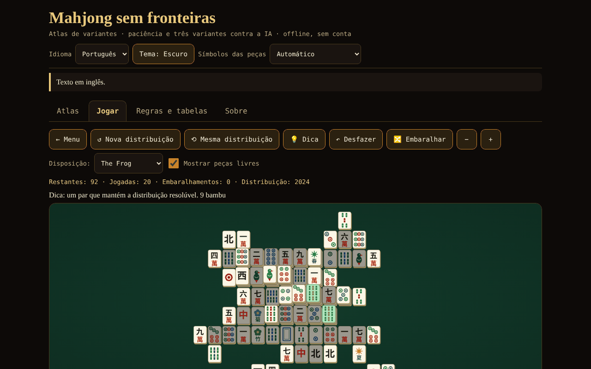

# Mahjong fără frontiere

[English](README.md) · [Română](README.ro.md) · [Français](README.fr.md) · [Italiano](README.it.md) · [Español](README.es.md) · **Português** · [Deutsch](README.de.md) · [Magyar](README.hu.md)

**Versão:** 1.2.3 · **Última atualização:** 2026-10-22

Idiomas da interface: **Română, English, Français, Italiano, Español, Português (PT), Deutsch, Magyar**

Atlas de variantes de mahjong, paciência com distribuições garantidamente resolúveis e mahjong de 4 jogadores contra 3 IA (riichi, Hong Kong, Sichuan) — um único ficheiro HTML, offline, sem conta e sem rede.

**Online:** https://chiuta.github.io/Mahjong-fara-frontiere/

## O que é

Uma aplicação de ficheiro único (`index.html`, ~263 KB) da série «sem fronteiras». Tem quatro separadores: **Atlas** (fichas sobre 8 variantes), **Jogar** (os jogos), **Regras e tabelas** (as tabelas de pontuação geradas diretamente a partir do código do jogo) e **Sobre**. A interface e todos os textos longos estão em 8 idiomas (romeno, inglês, francês, italiano, espanhol, português, alemão e húngaro).

«Mahjong» é um termo genérico. «Shanghai» é o nome comercial de um jogo de paciência de 1986; aqui o jogo chama-se «Mahjong paciência» (conhecido comercialmente como «Shanghai»); nenhuma marca registada aparece nos títulos.

## Funcionalidades (verificadas no código e por testes)

- **Mahjong paciência** com 8 disposições desenhadas pelo autor (Plana, Pirâmide, Cruz, Rã, Dragão, Cidadela, Borboleta, Torre; 72–144 peças). Peça livre = nada por cima E lado esquerdo ou direito livre. As flores combinam entre si, as estações entre si. As distribuições são geradas **ao contrário** (a partir do tabuleiro vazio), pelo que são resolúveis; sugestão (verificada ou pelo certificado de geração, enquanto as peças restantes ainda o respeitarem, ou com um solver de orçamento baixo de nós; caso contrário, assinalada «não verificada»), anulação ilimitada, mistura das peças restantes (também resolúvel), número de distribuição (seed) reproduzível, zoom, teclado.
- **Mahjong de 4 jogadores (você + 3 IA)** em três variantes: **riichi japonês**, **Hong Kong** e **Sichuan** (ver a tabela abaixo). Motor de regras separado da interface: compra, descarte, pung/chow/kong (com legalidade verificada pelo motor), vitória 4 conjuntos + par, 7 pares, 13 órfãos, pontuação, empates, rotação do dealer.
- **Riichi:** riichi, ippatsu, dora/ura-dora/aka, furiten (próprio, temporário, após riichi), kuikae, chankan, rinshan, abandono por 9 órfãos, empates especiais (quatro ventos, quatro kans, quatro riichi), nagashi mangan, pagamento do tenpai, honba e varetas de riichi; 42 entradas na tabela de yaku/yakuman/bónus; fu e han → pontos.
- **Hong Kong:** 136 ou 144 peças, flores e estações com peças de substituição, faan mínimo configurável (0–5), limite (8/10/13), sete pares opcional, dois modos de pagamento no descarte.
- **Sichuan:** 108 peças, naipe em falta, sem chow, vitórias múltiplas («batalha sangrenta», opcional), kong por adição apenas imediatamente após comprar a quarta peça (regra MIL), kongs pagos de imediato, penalizações no esgotamento.
- **IA didática** (heurística: shanten, peças restantes, defesa; sem LLM). **Não faz batota**: decide apenas a partir da informação pública + a sua própria mão; testado. Exceção explícita: a opção «Mostrar as mãos da IA (apenas para aprender)».
- Sugestão da IA para a sua jogada (assinalada como heurística, não como veredicto), velocidade da IA, duração (uma mão / 4 / 8 rotações).
- Peças desenhadas em SVG próprio (círculos, bambu, carateres 一…九, ventos 東南西北, dragões 中發白, flores, estações), com **deteção automática** da falta de glifos chineses e **alternativa com letras latinas** (também se pode escolher manualmente no cabeçalho).
- Tema escuro/claro, teclado completo (setas, Enter/Espaço), anúncios para leitores de ecrã, alvos táteis ≥ 44 px, `prefers-reduced-motion`, 390 px sem deslocação horizontal.
- Estatísticas simples, guardadas localmente, apenas no seu navegador; no separador **Sobre** o botão «Apagar as estatísticas locais» elimina-as (com confirmação).
- **Atalhos na paciência** (com o foco no tabuleiro): `H` sugestão, `U` ou `Ctrl+Z` anula, `S` mistura, além das setas e de Enter/Espaço; a lista aparece sob o tabuleiro, nas 8 línguas.
- **A partida de paciência é guardada automaticamente** (após cada jogada, anulação ou mistura) e pode ser retomada no separador **Jogar** com o botão «↻ Continuar o jogo guardado», nas 8 línguas. O registo é validado na leitura (disposição existente, pares completos, histórico coerente); dados corrompidos são ignorados. «Apagar as estatísticas locais» apaga também a partida guardada.

## Variantes

| Variante | Jogável? | ⚠ Aproximações (em resumo; lista completa na aplicação) |
|---|---|---|
| Mahjong paciência | sim | disposições próprias; abaixo de 144 peças usa-se um subconjunto de pares; a garantia de resolubilidade é para a distribuição e as misturas, não para qualquer jogada; a sugestão só é verificada por certificado ou quando o solver (de orçamento baixo) termina |
| Riichi japonês | sim | sem ron duplo/triplo (prioridade ao mais próximo), sem pao, renhou, chankan sobre kong oculto, uma/oka e «sudden death»; renchan sem agari-yame; kazoe yakuman ativo; sem yaku locais |
| Hong Kong | sim | a tabela faan → pontos («half spicy») e os modos de pagamento são uma escolha documentada; faltam a vitória com duplo kong e a instantânea com 7 flores; um único vencedor no descarte |
| Sichuan | sim | sem troca de 3 peças; o naipe em falta é público; o «porco de flores» paga 48 repartidos por igual (a fonte não diz a quem); penalizações simplificadas |
| MCR (oficial chinês) | só no atlas | — |
| Mahjong taiwanês (16 peças) | só no atlas | — |
| Mahjong americano | só no atlas | o cartão anual não é reproduzido |
| Sanma (3 jogadores, Japão) | só no atlas | — |

## Manual de utilização

1. Abra `index.html` (ou a página Online). Escolha a língua, o tema e, se as peças parecerem estranhas, «Símbolos das peças».
2. Separador **Atlas**: leia as fichas (regras em resumo, o que não é fiel, fontes); «▶ Jogar» leva ao jogo.
3. Separador **Jogar**: escolha o jogo, defina as opções (disposição / duração / faan mínimo etc., seed opcional) e prima «▶ Começar».
4. **Paciência:** prima duas peças livres idênticas (ou mova o cursor com as setas e prima Enter). «Sugestão» assinala um par; «Anular» volta atrás; «Misturar» regenera as posições restantes quando já não há jogadas.
5. **A mesa com IA:** quando é a sua vez, prima uma peça da sua mão para a descartar. Para o riichi, prima «Riichi» e depois uma peça assinalada. Quando uma IA descarta uma peça que lhe interessa, aparecem os botões Ron / Pung / Chow / Kong / Passar. «Sugestão da IA» mostra o que a IA faria. No fim da mão vê os yaku/faan/fan e as variações de pontuação.
6. O separador **Regras e tabelas** contém as tabelas de yaku, faan e fan exatamente como estão no código, o glossário e o guia das peças.

## Privacidade e rede

Nada sai do navegador: sem fetch/XHR, sem telemetria, sem tipos de letra nem scripts externos (CSP `default-src 'none'`, script permitido apenas por hash). Usa-se `localStorage` (língua, tema, opções, estatísticas, partida de paciência em curso) dentro de `try/catch`; a aplicação funciona também sem ele. As únicas ligações externas são os botões de apoio Buy Me a Coffee do rodapé (`rel="noopener"`).

## Limites e avisos

- **Não é um produto de competição completo.** Cada variante tem aproximações ⚠ (a tabela acima e as fichas da aplicação). As regras regionais diferem: em Hong Kong implementou-se a tabela «half spicy» e o pagamento no descarte como opção; no riichi, «atamahane» (um único vencedor no descarte); em Sichuan, sem troca de peças.
- **A IA é de nível fraco a médio.** Não tem modelos do adversário, não joga o riichi ofensivo/defensivo ao nível de perito e não calcula probabilidades completas. Contra uma base aleatória (60 partidas por variante, com o lugar da IA rodado): ganha por mão ~52,8 % no riichi, ~29,1 % em Hong Kong (com as bases aleatórias quase todas as mãos são empates, e o empate repete o dealer, pelo que as partidas são muito longas; a medida é fraca) e ~71,3 % em Sichuan (paridade = 25 %). Entre IA as partidas são muito agressivas (~89 % das mãos de riichi terminam com uma vitória).
- Todos os textos longos (atlas, glossário, notas de pontuação, tabelas de yaku riichi/Hong Kong/Sichuan, nomes e notas das 8 disposições do solitário) e a interface estão traduzidos para os 8 idiomas. Permanecem inalterados: o campo «src» das fichas do atlas (títulos da Wikipédia, citações) e os termos japoneses/chineses (yaku em japonês, riichi, dora, etc.). As traduções para francês, italiano, espanhol, português, alemão e húngaro são automáticas; a terminologia do mahjong (sobretudo hu, de) merece revisão por um jogador nativo.
- Em Hong Kong, o empate mantém o dealer (regra habitual): com um faan mínimo alto e adversários passivos o jogo pode demorar muito; baixe o faan mínimo ou escolha «uma só mão».
- «Uma só mão» pára o jogo após a primeira mão (não após a rotação do dealer).
- As traduções para francês, italiano, espanhol, português, alemão e húngaro foram feitas sem verificação por falantes nativos.
- Com tipos de letra sem glifos chineses passa-se automaticamente para letras latinas; se a deteção falhar, use o seletor do cabeçalho.

## Testes (fora do pacote: `scratchpad/new/games_work/Mahjong-fara-frontiere/`)

Resumo; comandos e resultados completos no relatório `new/reports/Mahjong-fara-frontiere.md`. Mão vencedora (4 conjuntos + par, 7 pares, 13 órfãos) comparada com uma implementação de referência por força bruta em milhares de mãos; tabela de pontos do riichi (111 células) e exemplos resolvidos da Wikipédia e do sloperama; invariante do número de peças; ≥300 partidas IA contra IA por variante sem erros; 1000 distribuições de paciência repetidas até ao tabuleiro vazio; verificação de que a IA não vê informação oculta; verificação com Playwright/Chromium da interface (todas as disposições, todas as variantes, 8 línguas, 390 px).

## Auditoria independente (resumo)

Uma auditoria separada (código e testes escritos independentemente do autor do motor) corrigiu: kong oculto/por adição oferecido imediatamente após um pung/chow (sem peça comprada); em Hong Kong, os «grandes ventos»/«quatro quadrados» formados apenas por honras eram pontuados 10 em vez de 13 faan; a «Sugestão» da paciência podia congelar a interface durante alguns segundos (agora um pequeno orçamento total); dados corrompidos de `localStorage` podiam impedir o arranque do jogo; em Sichuan, uma peça de kong «roubada» (chankan) continuava perdida da mão; etiqueta romena «sângele curge» → «bătălia de sânge». Continuam por verificar: a renderização em Firefox/Safari sem tipos de letra chineses (testado apenas em Chromium, com e sem tipos de letra CJK) e as traduções fr/it/es/pt/de sem falantes nativos.

## Fontes

Regras consultadas para a implementação e a verificação (artigos da Wikipédia, sem cópia de texto): «Mahjong», «Mahjong solitaire», «Japanese mahjong», «Japanese mahjong yaku», «Japanese mahjong scoring rules» (a tabela de pontos e os exemplos resolvidos), «Hong Kong mahjong», «Sichuan mahjong», «Mahjong Competition Rules», «Taiwanese mahjong», «American mahjong»; o exemplo de cálculo do fu (90 fu) de sloperama.com. A Wikipédia pode conter erros ou diferenças regionais; as fichas do atlas dizem que variante foi escolhida.

## Execução local

Abra `index.html` num navegador (sem servidor, sem instalação). Para reconstruir a partir das fontes: `node build_site.js` na pasta de trabalho (o script não faz chamadas de rede).

## Licença

MIT — veja o ficheiro `LICENSE`.

## Autor

Alexio — Alexandru-Ionuț Chiuță · alexio@trom.tf

## Resumo
«Mahjong sem fronteiras» é uma aplicação HTML de ficheiro único, offline: um atlas de oito variantes de mahjong, uma paciência de mahjong com oito disposições desenhadas pelo autor e distribuições construídas ao contrário (garantidamente resolúveis), e um mahjong de quatro lugares contra três IA heurísticas em três variantes jogáveis — riichi japonês, Hong Kong e Sichuan. MCR, taiwanês, americano e de três jogadores (sanma) são apenas do atlas. As peças são desenhadas em SVG com uma alternativa automática de letras latinas quando faltam os glifos chineses. A interface está em romeno, inglês, francês, italiano, espanhol, português, alemão e húngaro; todos os textos longos (atlas, glossário, notas de pontuação) também estão traduzidos. A IA não faz batota (só vê a informação pública e a sua própria mão; uma opção explícita de aprendizagem «mostrar as mãos da IA» é a única exceção). Cada aproximação de regras está assinalada com ⚠ na aplicação e na tabela acima. Sem acesso à rede, sem rastreamento; CSP estrita. Licença: MIT (ver LICENSE).

## Novas funcionalidades (v1.1.0)

- **Duelo de paciência em rede** («Duelo em rede (mesmo tabuleiro)»): ambos os jogadores recebem o mesmo tabuleiro (a mesma seed e disposição) e resolvem em paralelo; cada um vê o progresso do outro, e no fim comparam-se os resultados. No duelo ficam desativadas as sugestões, o jogo novo e a retoma, e o registo local não é tocado. Não é Mahjong de quatro jogadores: é tudo o que a paciência permite honestamente. A ligação faz-se diretamente entre os dois navegadores (WebRTC), sem servidor nosso: troca dois textos (oferta/resposta), como texto ou código QR, por qualquer canal à sua escolha. Por predefinição não é contactado nenhum servidor STUN; pode introduzir-se um manualmente na janela de ligação, apenas se o quiser. Se a ligação se interromper, a aplicação mostra-o e pode retomar o jogo a partir do registo de jogadas.
- **Leitura em voz alta das fichas do atlas** (botão «Ouvir», FFF.tts).
- Kit comum (core, label, bundle, qr, p2p, tts).
- Os novos textos estão em todas as línguas da aplicação (incluindo hu/de onde existe um sistema i18n); as traduções automáticas não estão verificadas por falantes nativos.
- Testes: `tests/fff-r8.test.mjs` (rede bloqueada, dois contextos ligados através da caixa de diálogo real, axe 0 violações a 1280 e 360 px).

## Histórico / Changelog

### 1.2.3 — 2026-10-22

apagar as estatísticas pede confirmação na caixa de diálogo integrada do kit (traduzida em 8 idiomas) em vez do `window.confirm()` bloqueante; foco de teclado visível; a etiqueta de versão tem uma área tátil adequada; teste `tests/r9-confirm.test.mjs`. A etiqueta técnica lista agora os 8 idiomas da interface.

### 1.2.2 — 2026-10-22
- Glossário: os termos «Muro / Muro morto» e «Naipe em falta» estão traduzidos em todos os idiomas.

### 2026-10-19 (v1.2.1)
- Todos os textos longos (atlas das 8 variantes, glossário, notas de pontuação, cerca de 90 entradas de yaku, as 8 disposições do solitário) estão traduzidos para fr, it, es, pt, de, hu; a nota «texto em inglês» já não aparece. Traduções automáticas, não verificadas por falantes nativos.

### 14 de outubro de 2026 (v1.1.0)
- Novidade: duelo de paciência em rede (mesmo tabuleiro), leitura em voz alta das fichas, kit comum, testes.

- 1.0.0 — 2026-10-12: a versão e a data da última atualização são apresentadas na aplicação
- **11 de outubro de 2026** (ronda 7) — gravação automática e retoma da partida de paciência (validadas, 7 línguas, incluídas no texto de privacidade); testado no navegador (jogada → recarregar → retoma com o mesmo número de peças; gravação corrompida ignorada); 0 erros, axe 0 violações a 1280×800 e 360×740.
- **11 de outubro de 2026** — atalhos de teclado na paciência (H / U ou Ctrl+Z / S) com explicação sob o tabuleiro, botão «Apagar as estatísticas locais» em Sobre (textos em 7 línguas); hash CSP do script recalculado; testado (0 erros, 0 violações CSP, axe-core 0 violações a 1280×800 e 360×740).
- **11 de outubro de 2026** — a mensagem na mesa já não diz «You is thinking…» (quando a vez formal é sua mas a ação é resolvida pelos outros, aparece «A aguardar os outros jogadores…», nas 7 línguas); o contador «Jogadas» da paciência já não é reposto na mistura (tem o seu próprio contador, mantido na mistura, diminuído na anulação).
- Acessibilidade: a barra de separadores está num `nav` com um `tablist` separado, os títulos das fichas do Atlas são `h2` (ordem correta dos títulos), o widget de apoio tem o papel `complementary`; axe-core: 0 violações a 1280×800 e 360×740. O hash CSP do script foi recalculado. A aplicação não tem número de versão.
