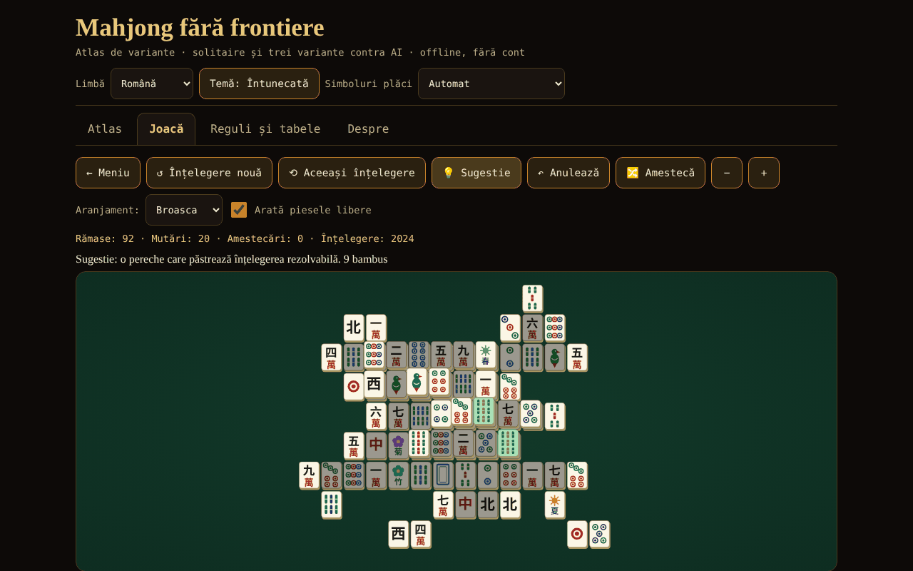

# Mahjong fără frontiere

[English](README.md) · **Română** · [Français](README.fr.md) · [Italiano](README.it.md) · [Español](README.es.md) · [Português](README.pt.md) · [Deutsch](README.de.md) · [Magyar](README.hu.md)

**Versiune:** 1.2.4 · **Ultima actualizare:** 2026-10-22

Limbile interfeței: **Română, English, Français, Italiano, Español, Português (PT), Deutsch, Magyar**

Atlas de variante de mahjong, solitaire cu înțelegeri garantat rezolvabile și mahjong cu 4 jucători contra 3 AI (riichi, Hong Kong, Sichuan) — un singur fișier HTML, offline, fără cont și fără rețea.

**Live:** https://chiuta.github.io/Mahjong-fara-frontiere/

## Ce este

O aplicație dintr-un singur fișier (`index.html`, ~263 KB) din seria „fără frontiere”. Are patru file: **Atlas** (fișe despre 8 variante), **Joacă** (jocurile), **Reguli și tabele** (tabelele de scor generate chiar din codul jocului) și **Despre**. Interfața și toate textele lungi sunt în 8 limbi (română, engleză, franceză, italiană, spaniolă, portugheză, germană și maghiară).

„Mahjong” este un termen generic. „Shanghai” este denumirea comercială a unui joc de solitaire din 1986; aici jocul se numește „Mahjong solitaire” (cunoscut comercial ca „Shanghai”); nicio marcă înregistrată nu apare în titluri.

## Funcții (verificate în cod și prin teste)

- **Mahjong solitaire** cu 8 aranjamente desenate de autor (Plat, Piramidă, Cruce, Broasca, Dragon, Cetate, Fluture, Turn; 72–144 de plăci). Piesă liberă = nimic deasupra ȘI stânga sau dreapta liberă. Florile se potrivesc între ele, anotimpurile între ele. Înțelegerile sunt generate **invers** (din tabla goală), deci sunt rezolvabile; sugestie (verificată fie prin certificatul de generare, când piesele rămase îl mai respectă, fie cu un solver cu buget mic de noduri; altfel marcată „neverificată”), anulare nelimitată, amestecare a pieselor rămase (tot rezolvabilă), număr de înțelegere (seed) reproductibil, zoom, tastatură.
- **Mahjong cu 4 jucători (tu + 3 AI)** în trei variante: **riichi japonez**, **Hong Kong** și **Sichuan** (vezi tabelul de mai jos). Motor de reguli separat de interfață: tragere, aruncare, pung/chow/kong (cu legalitate verificată de motor), câștig 4 seturi + pereche, 7 perechi, 13 orfani, scorare, remize, rotația dealerului.
- **Riichi:** riichi, ippatsu, dora/ura-dora/aka, furiten (propriu, temporar, după riichi), kuikae, chankan, rinshan, abandon 9 orfani, remize speciale (patru vânturi, patru kan-uri, patru riichi), nagashi mangan, plata tenpai, honba și bețe riichi; 42 de intrări în tabelul de yaku/yakuman/bonusuri; fu și han → puncte.
- **Hong Kong:** 136 sau 144 de plăci, flori și anotimpuri cu piese de înlocuire, faan minim configurabil (0–5), plafon (8/10/13), șapte perechi opțional, două moduri de plată la aruncare.
- **Sichuan:** 108 plăci, culoare lipsă, fără chow, câștiguri multiple („bătălia de sânge”, opțional), kong prin adăugare doar imediat după tragerea celei de-a patra piese (regula MIL), kong-uri plătite imediat, penalizări la epuizare.
- **AI didactic** (euristic: shanten, piese rămase, apărare; fără LLM). **Nu trișează**: decide doar din informația publică + propria mână; testat. Excepție explicită: opțiunea „Arată mâinile AI (doar pentru învățare)”.
- Sugestie AI pentru mutarea ta (marcată ca euristică, nu verdict), viteza AI, durată (o mână / 4 / 8 rotații).
- Plăci desenate în SVG propriu (cercuri, bambus, caractere 一…九, vânturi 東南西北, dragoni 中發白, flori, anotimpuri), cu **detectare automată** a lipsei glifelor chinezești și **alternativă cu litere latine** (se poate alege și manual din antet).
- Temă întunecată/luminoasă, tastatură completă (săgeți, Enter/Spațiu), anunțuri pentru cititoare de ecran, țintele tactile ≥ 44 px, `prefers-reduced-motion`, 390 px fără derulare orizontală.
- Statistici simple, salvate local, doar în browserul tău; în fila **Despre** butonul „Șterge statisticile locale” le elimină (cu confirmare).
- **Scurtături la solitaire** (cu focusul pe tablă): `H` sugestie, `U` sau `Ctrl+Z` anulează, `S` amestecă, în plus față de săgeți și Enter/Spațiu; lista apare sub tablă, în cele 8 limbi.
- **Partida de solitaire se salvează automat** (după fiecare mutare, anulare sau amestecare) și poate fi reluată din fila **Joacă** cu butonul „↻ Continuă jocul salvat”, în cele 8 limbi. Salvarea este validată la citire (aranjament existent, perechi complete, istoric coerent); date corupte sunt ignorate. „Șterge statisticile locale” șterge și partida salvată.

## Variante

| Variantă | Jucabilă? | ⚠ Aproximări (pe scurt; lista completă în aplicație) |
|---|---|---|
| Mahjong solitaire | da | aranjamente proprii; sub 144 de plăci se folosește un subset de perechi; garanția de rezolvabilitate e pentru înțelegere și amestecări, nu pentru orice mutare; sugestia e verificată doar prin certificat sau când solverul (buget mic) termină |
| Riichi japonez | da | fără ron dublu/triplu (prioritate celui mai apropiat), fără pao, renhou, chankan pe kan ascuns, uma/oka și „sudden death”; renchan fără agari-yame; kazoe yakuman activ; fără yaku locale |
| Hong Kong | da | tabelul faan → puncte („half spicy”) și modurile de plată sunt alegerea documentată; lipsesc câștigul cu dublu kong și cel instant cu 7 flori; un singur câștigător la aruncare |
| Sichuan | da | fără schimbul de 3 plăci; culoarea lipsă e publică; „porcul de floare” plătește 48 împărțit egal (sursa nu spune cui); penalizări simplificate |
| MCR (oficial chinez) | doar în atlas | — |
| Mahjong taiwanez (16 plăci) | doar în atlas | — |
| Mahjong american | doar în atlas | cardul anual nu e reprodus |
| Sanma (3 jucători, Japonia) | doar în atlas | — |

## Manual de utilizare

1. Deschide `index.html` (sau pagina Live). Alege limba, tema și, dacă plăcile arată ciudat, „Simboluri plăci”.
2. Fila **Atlas**: citește fișele (reguli în scurt, ce nu e fidel, surse); „▶ Joacă” duce la joc.
3. Fila **Joacă**: alege jocul, setează opțiunile (aranjament / durată / faan minim etc., seed opțional) și apasă „▶ Începe”.
4. **Solitaire:** apasă două plăci libere identice (sau mută cursorul cu săgețile și apasă Enter). „Sugestie” marchează o pereche; „Anulează” revine; „Amestecă” regenerează pozițiile rămase când nu mai sunt mutări.
5. **Masa cu AI:** când e rândul tău, apasă o piesă din mână pentru a o arunca. Pentru riichi apasă „Riichi”, apoi o piesă marcată. Când un AI aruncă o piesă care te interesează apar butoanele Ron / Pung / Chow / Kong / Pas. „Sugestie AI” arată ce ar face AI-ul. La final de mână vezi yaku/faan/fan și schimbările de scor.
6. Fila **Reguli și tabele** conține tabelele de yaku, faan și fan exact așa cum sunt în cod, glosarul și ghidul plăcilor.

## Confidențialitate și rețea

Nimic nu pleacă din browser: fără fetch/XHR, fără telemetrie, fără fonturi sau scripturi externe (CSP `default-src 'none'`, script permis doar prin hash). Se folosește `localStorage` (limbă, temă, opțiuni, statistici, partida de solitaire în curs) în `try/catch`; aplicația merge și fără el. Singurele legături externe sunt butoanele de sprijin Buy Me a Coffee din subsol (`rel="noopener"`).

## Limite și avertismente

- **Nu este un produs complet de competiție.** Fiecare variantă are aproximări ⚠ (tabelul de mai sus și fișele din aplicație). Reguli regionale diferă: la Hong Kong s-a implementat tabelul „half spicy” și plata la aruncare ca opțiune; la riichi, „atamahane” (un singur câștigător la aruncare); la Sichuan, fără schimbul de plăci.
- **AI-ul este slab-spre-mediu.** Nu are modele de adversar, nu joacă riichi-ul ofensiv/defensiv la nivel de expert și nu calculează probabilități complete. Contra unei baze aleatoare (60 de jocuri pe variantă, locul AI-ului rotit): câștigă pe mână ~52,8% la riichi, ~29,1% la Hong Kong (cu bazele aleatoare aproape toate mâinile sunt remize, iar remiza repetă dealerul, deci jocurile sunt foarte lungi; măsura e slabă) și ~71,3% la Sichuan (paritate = 25%). Între AI-uri partidele sunt foarte agresive (~89% din mâinile de riichi se termină cu câștig).
- Toate textele lungi (atlas, glosar, notele de scor, tabelele de yaku riichi/Hong Kong/Sichuan, numele și notele celor 8 aranjamente de solitaire) și interfața sunt traduse în toate cele 8 limbi. Rămân neschimbate: câmpul „src” al fișelor din atlas (titluri Wikipedia, citări) și termenii japonezi/chinezi (yaku în japoneză, riichi, dora etc.). Traducerile în franceză, italiană, spaniolă, portugheză, germană și maghiară sunt automate; terminologia de mahjong (mai ales hu, de) merită revizuită de un jucător nativ.
- La Hong Kong, remiza păstrează dealerul (regulă obișnuită): cu un faan minim mare și adversari pasivi jocul poate dura mult; coboară faan-ul minim sau alege „o singură mână”.
- „O singură mână” oprește jocul după prima mână (nu după rotația dealerului).
- Traducerile din franceză, italiană, spaniolă, portugheză, germană și maghiară sunt făcute fără verificare de către vorbitori nativi.
- Cu fonturi fără glife chinezești se trece automat pe litere latine; dacă detecția greșește, folosește selectorul din antet.

## Teste (în afara pachetului: `scratchpad/new/games_work/Mahjong-fara-frontiere/`)

Rezumat; comenzi și rezultate complete în raportul `new/reports/Mahjong-fara-frontiere.md`. Mâna câștigătoare (4 seturi + pereche, 7 perechi, 13 orfani) comparată cu o implementare de referință prin forță brută pe mii de mâini; tabelul de puncte riichi (111 celule) și exemple lucrate din Wikipedia și sloperama; invariantul numărului de plăci; ≥300 de partide AI contra AI per variantă fără erori; 1000 de înțelegeri solitaire reluate până la tabla goală; verificare că AI-ul nu vede informație ascunsă; verificare Playwright/Chromium a interfeței (toate aranjamentele, toate variantele, 8 limbi, 390 px).

## Audit independent (rezumat)

Un audit separat (cod și teste scrise independent de autorul motorului) a corectat: kong ascuns/prin adăugare oferit imediat după pung/chow (fără piesă trasă); la Hong Kong „vânturi mari”/„patru careuri” formate doar din onori erau punctate 10 în loc de 13 faan; „Sugestie” din solitaire putea îngheța interfața câteva secunde (acum buget total mic); date corupte din `localStorage` puteau opri pornirea jocului; la Sichuan, o piesă de kong „furată” (chankan) rămânea pierdută din mână; etichetă română „sângele curge” → „bătălia de sânge”. Rămân neverificate: randarea în Firefox/Safari fără fonturi chinezești (testat doar în Chromium, cu și fără fonturi CJK) și traducerile fr/it/es/pt/de fără vorbitori nativi.

## Surse

Reguli consultate pentru implementare și verificare (articole Wikipedia, fără copiere de text): „Mahjong”, „Mahjong solitaire”, „Japanese mahjong”, „Japanese mahjong yaku”, „Japanese mahjong scoring rules” (tabelul de puncte și exemplele lucrate), „Hong Kong mahjong”, „Sichuan mahjong”, „Mahjong Competition Rules”, „Taiwanese mahjong”, „American mahjong”; exemplul de calcul al fu-ului (90 fu) de pe sloperama.com. Wikipedia poate conține erori sau diferențe regionale; fișele din atlas spun ce variantă s-a ales.

## Rulare locală

Deschide `index.html` într-un browser (fără server, fără instalare). Pentru a reconstrui din surse: `node build_site.js` în folderul de lucru (scriptul nu face apeluri de rețea).

## Licență

MIT — vezi fișierul `LICENSE`.

## Autor

Alexio — Alexandru-Ionuț Chiuță · alexio@trom.tf

## Rezumat

„Mahjong fără frontiere” este o aplicație HTML offline într-un singur fișier: un atlas de opt variante de mahjong, un solitaire mahjong cu opt aranjamente desenate propriu și mâini construite invers (garantat rezolvabile), și mahjong pe patru locuri împotriva a trei AI-uri euristice în trei variante jucabile — riichi japonez, Hong Kong și Sichuan. MCR, taiwanez, american și pentru trei jucători (sanma) sunt doar în atlas. Piesele sunt desenate în SVG, cu rezervă automată în litere latine când lipsesc glifele chinezești. Interfața este în română, engleză, franceză, italiană, spaniolă, portugheză și germană; și toate textele lungi (atlas, glosar, notele de scor) sunt traduse. AI-ul nu trișează (vede doar informațiile publice și propria mână; o opțiune explicită de învățare „arată mâinile AI” este singura excepție). Fiecare aproximare de regulă este marcată ⚠ în aplicație și în tabelul de mai sus. Fără acces la rețea, fără urmărire; CSP strict. Licență: MIT (vezi LICENSE).

## Funcții noi (v1.1.0)

- **Duel de solitaire pe rețea** („Duel pe rețea (aceeași tablă)”): ambii jucători primesc aceeași tablă (aceeași sămânță și aranjament) și rezolvă în paralel; fiecare vede progresul celuilalt, iar la final se compară rezultatele. În duel sunt oprite sugestiile, jocul nou și reluarea, iar salvarea locală nu e atinsă. Nu este Mahjong cu patru jucători: atât permite onest solitaire-ul. Conexiunea se face direct între cele două browsere (WebRTC), fără server al nostru: schimbi două texte (ofertă/răspuns), ca text sau cod QR, prin orice canal ales de tine. Implicit nu se contactează niciun server STUN; unul poate fi introdus manual în fereastra de conectare, doar dacă îl vrei. Dacă legătura se întrerupe, aplicația o arată și poate relua jocul din jurnalul mutărilor.
- **Citire cu voce a fișelor din atlas** (buton „Ascultă”, FFF.tts).
- Kit comun (core, label, bundle, qr, p2p, tts).
- Textele noi sunt în toate limbile aplicației (inclusiv hu/de unde există sistem i18n); traducerile automate sunt neverificate nativ.
- Teste: `tests/fff-r8.test.mjs` (rețea blocată, două contexte conectate prin dialogul real, axe 0 violări la 1280 și 360 px).

## Istoric / Changelog

### 1.2.4 — 2026-10-22

fff-kit 1.1.2: PBKDF2 600 000 iterații, protecție anti-clickjacking.

### 1.2.3 — 2026-10-22

ștergerea statisticilor cere confirmarea în dialogul inline al kitului (tradus în 8 limbi), nu prin `window.confirm()` blocant; focus de tastatură vizibil; eticheta de versiune are ținta tactilă potrivită; test `tests/r9-confirm.test.mjs`. Eticheta tehnică listează acum toate cele 8 limbi ale interfeței.

### 1.2.2 — 2026-10-22
- Glosar: termenii „Zid / Zid mort” și „Culoare lipsă” sunt traduși în toate limbile.

### 2026-10-19 (v1.2.1)
- Toate textele lungi (atlasul celor 8 variante, glosarul, notele de scor, circa 90 de intrări yaku, cele 8 aranjamente de solitaire) sunt traduse în fr, it, es, pt, de, hu; nota „text în engleză” nu mai apare. Traduceri automate, neverificate de vorbitori nativi.

### 14 octombrie 2026 (v1.1.0)
- Nou: duel de solitaire pe rețea (aceeași tablă), citirea fișelor cu voce, kit comun, teste.

- 1.0.0 — 2026-10-12: versiunea și data ultimei actualizări sunt afișate în aplicație
- **11 octombrie 2026** (runda 7) — salvare automată și reluare a partidei de solitaire (validată, 7 limbi, inclusă în textul de confidențialitate); testat în browser (mutare → reîncărcare → reluare cu același număr de plăci; salvare coruptă ignorată); 0 erori, axe 0 violări la 1280×800 și 360×740.
- **11 octombrie 2026** — scurtături de tastatură la solitaire (H / U sau Ctrl+Z / S) cu explicație sub tablă, buton „Șterge statisticile locale” în Despre (texte în 7 limbi); hash-ul CSP al scriptului recalculat; testat (0 erori, 0 încălcări CSP, axe-core 0 violări la 1280×800 și 360×740).
- **11 octombrie 2026** — mesajul de la masă nu mai spune „You is thinking…” (când rândul formal e al tău, dar acțiunea e rezolvată de ceilalți, apare „Se așteaptă ceilalți jucători…”, în toate cele 7 limbi); contorul „Mutări” din solitaire nu se mai resetează la amestecare (are contor propriu, păstrat la amestecare, scăzut la anulare).
- Accesibilitate: bara de file e într-un `nav` cu `tablist` separat, titlurile fișelor din Atlas sunt `h2` (ordine corectă a titlurilor), widgetul de sprijin are rol `complementary`; axe-core: 0 violări la 1280×800 și 360×740. Hash-ul CSP al scriptului a fost recalculat. Aplicația nu are număr de versiune.
